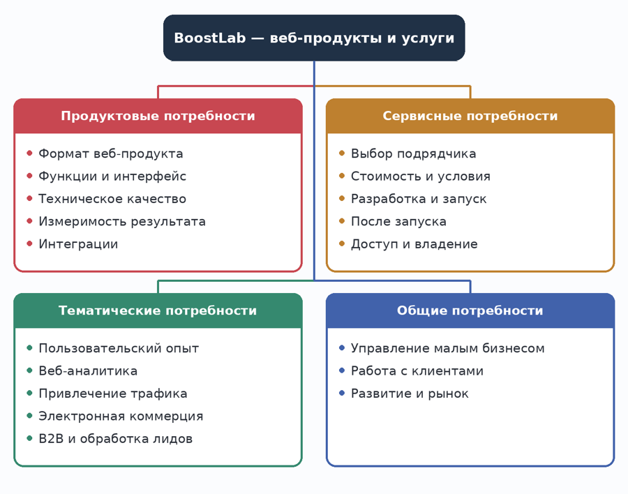
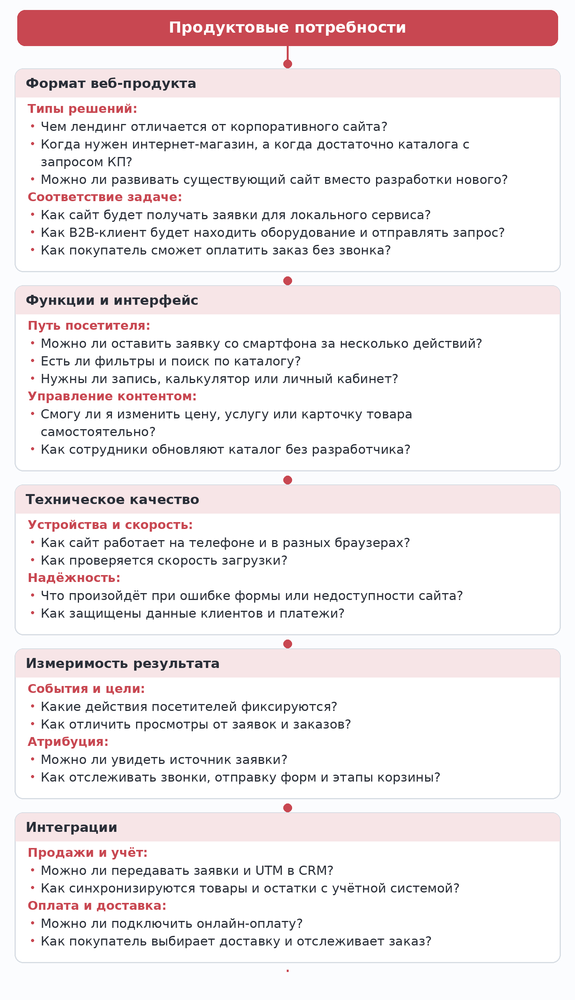
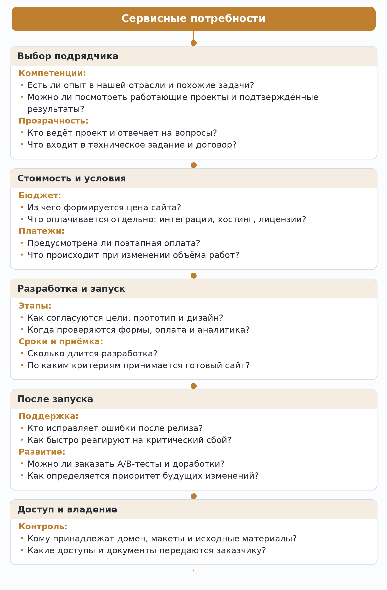
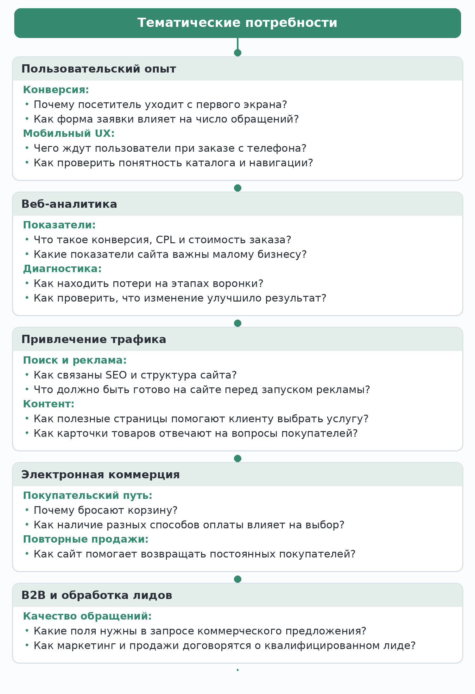
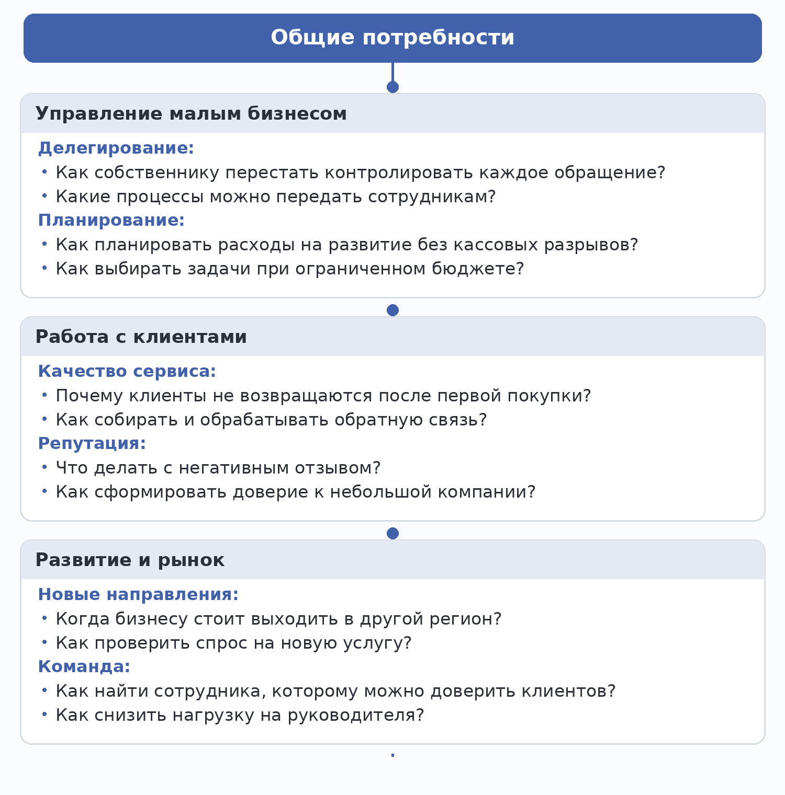

# Лабораторная работа № 1

Профайл аудитории и Карты информационных потребностей

Цель работы: Изучение правил и особенностей разработки главных документов рекламной стратегии – Аватара клиента и Карты информационных потребностей.

## 1. Теоретические основы разработки Аватара клиента

Целевая аудитория (ЦА) — группы потенциальных покупателей, объединённые сходными задачами и условиями выбора продукта. Социально-демографический портрет описывает возраст, место проживания, занятость, доход и образование; социально-психологический — боли, мотивацию, страхи, ценности, привычки и критерии выбора.

Аватар клиента — рабочая модель типичного представителя отдельного сегмента ЦА. Он помогает определить, кому адресовать рекламный текст, какие потребности и возражения учитывать, где искать аудиторию и как объяснять ценность услуги. Данные для Аватара получают через интервью с клиентами и сотрудниками, анализ обращений, отзывов и профильных сообществ. Для выделения типичных характеристик сведения сопоставляются между представителями одного сегмента: повторяющиеся задачи и мотивы включаются в Аватар, индивидуальные исключения исключаются.

Карта информационных потребностей — разветвлённый перечень вопросов аудитории о продукте и вокруг него. Её основные ветви: продуктовые, сервисные, тематические и общие потребности. В отличие от Аватаров отдельных сегментов карта создаётся для продуктовой категории в целом и дополняется по мере появления новых вопросов.

### Компания и сегменты целевой аудитории

BoostLab — веб-студия, специализирующаяся на разработке и развитии сайтов для бизнеса. Основные услуги компании включают создание лендингов, корпоративных сайтов и интернет-магазинов, UX (пользовательский опыт)-проектирование, настройку веб-аналитики и оптимизацию после запуска.

В основе позиционирования BoostLab лежит решение конкретных бизнес-задач: привлечение клиентов, увеличение онлайн-продаж и повышение эффективности сайта. Поэтому компания предлагает не только разработку веб-продукта, но и инструменты для оценки результатов его работы.

Основная целевая аудитория BoostLab — малый бизнес, которому необходим функциональный сайт, но нецелесообразно содержать собственную команду веб-разработки. В первую очередь это компании, уже использующие интернет для привлечения клиентов или планирующие развивать онлайн-продажи. Средний бизнес рассматривается как дополнительный сегмент при наличии соответствующих задач и бюджета. Крупные предприятия со сложной ИТ-инфраструктурой не входят в приоритетную аудиторию студии.

Целевая аудитория сегментирована по характеру бизнес-задач, решаемых с помощью веб-продукта. Выделены три основных сегмента:

Малый бизнес в сфере услуг. Мастерские, ремонтные компании и другие сервисные организации. Основная потребность — получение заявок и звонков с сайта, контроль эффективности рекламы. Типичный заказчик — собственник бизнеса.

Малый торговый бизнес. Небольшие магазины и локальные бренды, развивающие собственные онлайн-продажи. Основная потребность — интернет-магазин с каталогом, оплатой, учётом заказов и аналитикой. Типичный заказчик — владелец магазина или бренда.

Малый B2B-бизнес (business-to-business — взаимодействие компаний). Поставщики оборудования, материалов и других товаров для организаций. Основная потребность — корпоративный сайт-каталог с подробным представлением продукции, получением запросов на коммерческие предложения и передачей заявок в CRM (систему управления взаимоотношениями с клиентами). Типичный заказчик — собственник или руководитель коммерческого направления.

Для каждого сегмента разработан отдельный Аватар клиента. Имена Аватаров условные: характеристика сегмента не зависит от пола собственника.

## 2. Аватары клиентов

Аватар № 1 — Владелец малого бизнеса в сфере услуг

Сегмент ЦА: собственники небольших компаний, предоставляющих услуги населению и организациям, самостоятельно участвующие в управлении бизнесом.

Имя: Игорь / Мария

Возраст: 45 лет (основной диапазон сегмента — 35–55 лет).

Страна / город проживания: Россия, Казахстан, Беларусь, страны Балтии (Латвия, Литва, Эстония).

Семейное положение: Женат / замужем, есть ребёнок.

Род деятельности: Владелец малого бизнеса в сфере услуг: автосервис, мастерская по ремонту бытовой техники, ремонтно-строительная компания, клининговая служба, ателье, типография, компания по грузоперевозкам или другой локальный сервис. Лично участвует в управлении компанией.

Доход (в месяц): Нестабильный личный доход, зависящий от прибыли компании после обязательных расходов. Может значительно различаться от месяца к месяцу.

Образование: Среднее профессиональное или высшее. Специальность может соответствовать направлению бизнеса.

Боли:

- непрозрачность привлечения клиентов: непонятно, какие рекламные каналы приносят обращения, а какие расходуют бюджет без результата;

- нестабильная загрузка: периоды нехватки заказов сменяются наплывом клиентов, с которым сотрудники не всегда справляются;

- потеря потенциальных клиентов из-за пропущенных звонков, необработанных сообщений, неудобной записи или отсутствия обратной связи;

- нехватка времени на управление, продвижение и развитие бизнеса из-за постоянного решения текущих проблем;

- усталость и эмоциональное выгорание из-за высокой ответственности, финансовой неопределённости и недостатка времени на семью;

- сложности с обработкой отзывов и жалоб, отсутствие понятного механизма выявления и устранения повторяющихся проблем;

- высокие текущие расходы и необходимость иногда снижать цены или нести дополнительные затраты ради удержания клиентов;

- зависимость от квалифицированных сотрудников, сложности с их загрузкой, мотивацией и удержанием;

- зависимость от сарафанного радио и сомнения в целесообразности интернет-рекламы;

- ограниченность средств на развитие: большая часть доходов уходит на поддержание текущей деятельности.

Оперативные задачи:

- снизить личную операционную нагрузку за счёт автоматизации повторяющихся задач и делегирования;

- наладить учёт заявок и определить эффективность используемых рекламных каналов;

- сократить потери обращений между первым контактом клиента и оформлением заказа;

- упростить онлайн-запись, обработку сообщений и передачу заявок сотрудникам;

- сделать загрузку сотрудников более предсказуемой и сократить периоды простоя;

- улучшить работу с отзывами и повторными обращениями клиентов;

- оценить, оправдывают ли расходы на интернет-продвижение получаемые заказы;

- получить понятные инструменты, которыми сотрудники смогут пользоваться без постоянного участия собственника.

Глобальные мечты:

- создать устойчивый бизнес, способный работать без постоянного личного контроля;

- передать текущие операции сотрудникам и сосредоточиться на развитии компании и поиске партнёров;

- расширить бизнес, увеличить прибыль и сформировать финансовую независимость;

- обеспечить семье высокий уровень жизни и дать ребёнку хорошее образование;

- иметь достаточно свободного времени для семьи, отдыха и собственного здоровья;

- создать компанию с хорошей репутацией, которую клиенты рекомендуют другим;

- стать одним из наиболее востребованных поставщиков услуг в своей нише.

Страхи:

- разорение и потеря основного источника дохода семьи;

- постоянный рост расходов, налогов, стоимости материалов и заработной платы;

- уход квалифицированных сотрудников и постоянных клиентов к конкурентам;

- снижение спроса и неспособность бизнеса адаптироваться к изменениям рынка;

- потеря обращений из-за технических сбоев сайта или системы записи;

- утечка клиентских данных, взлом сайта, потеря доступа к домену и связанным сервисам;

- финансовые и юридические последствия серьёзных ошибок, претензий клиентов или нарушения обязательств;

- профессиональное и личное выгорание, ухудшение здоровья из-за переработок;

- ухудшение отношений с семьёй из-за постоянного отсутствия дома;

- многолетняя работа на пределе возможностей без существенного развития бизнеса.

Какие шаги предпринимает, чтобы избавиться от болей и страхов, решить задачи?

- пытается планировать рабочее время, расходы и загрузку сотрудников;

- нанимает администраторов, менеджеров или других специалистов для передачи части обязанностей;

- использует таблицы, программы учёта, CRM и сервисы онлайн-записи; осваивает их самостоятельно;

- пробует автоматизировать отдельные задачи с помощью ИИ, но сталкивается с ограничениями собственных технических знаний;

- заказывает простой сайт, пробует контекстную рекламу или самостоятельно ведёт социальные сети;

- продолжает использовать рекомендации знакомых и постоянных клиентов как способ продвижения;

- изучает сайты, цены, предложения и организацию обслуживания у конкурентов;

- читает материалы о рекламе, смотрит обучающие видео, обращается за советами к другим предпринимателям;

- пробует самостоятельно изменять сайт или просит помощи у знакомых с техническими знаниями;

- ищет подрядчиков, способных настроить сайт, аналитику и необходимые интеграции без его постоянного участия;

- сокращает необязательные расходы, чтобы выделить средства на сотрудников, автоматизацию и развитие.

Что раздражает и сердит?

- необходимость разбираться в сложных технических и рекламных инструментах вместо управления бизнесом;

- подрядчики, которые критикуют предыдущих исполнителей, но сами не могут объяснить ожидаемый результат;

- непрозрачные условия сотрудничества, дополнительные платежи и непредсказуемые расходы;

- срыв сроков, отсутствие обратной связи и нежелание исполнителей брать ответственность за свою работу;

- непонятные объяснения, профессиональный жаргон, общие обещания без конкретики;

- высокая стоимость услуг без понятного обоснования;

- постоянное подорожание материалов, аренды и других обязательных расходов;

- недовольство сотрудников, особенно когда компания и так испытывает финансовые трудности;

- истории чужого лёгкого успеха на фоне собственных затяжных проблем;

- непонимание со стороны близких, которым не хватает его внимания и времени.

Жизненные ценности:

- семья;

- финансовая стабильность;

- безопасность;

- здоровье;

- самостоятельность и свобода;

- успех и профессиональная репутация;

- ответственность за своё дело и сотрудников.

Манера общения: Не имеет значения.

На каких площадках потребляет профессиональную / познавательную / развлекательную / новостную информацию:

- социальные сети и мессенджеры: Telegram, ВКонтакте; Instagram и Facebook;

- видео: YouTube, Rutube — профессиональные обзоры, интервью с предпринимателями, обучение;

- деловые и новостные СМИ: РБК, «Ведомости», «Коммерсантъ», региональные издания;

- профессиональные ресурсы: отраслевые сайты, форумы и сообщества по своему направлению деятельности;

- материалы о бизнесе: Контур.Журнал, Т—Бизнес секреты, VC.ru, «Мой бизнес»;

- официальная информация: сайты ФНС, государственных и региональных организаций поддержки предпринимательства;

- личные контакты: общение с другими предпринимателями, поставщиками и участниками отраслевых мероприятий.

Топ интересующих тем:

- экономика, законодательство и политика, влияющие на предпринимательство;

- развитие и управление малым бизнесом;

- профессиональные технологии, оборудование и материалы своей отрасли;

- привлечение и удержание клиентов;

- реклама и продвижение услуг;

- автоматизация и сокращение операционной нагрузки;

- управление сотрудниками и финансами;

- семья, отдых, здоровье и личные интересы.

Какую роль в жизни клиента играет продукт? Периодическое приобретение услуги с дальнейшим самостоятельным использованием веб-продукта. BoostLab разрабатывает сайт, настраивает необходимую аналитику и интеграции, помогает с запуском, исправляет выявленные недостатки и передаёт доступы и инструкции. В дальнейшем клиент может самостоятельно работать с системой, при необходимости обращаясь за консультациями или отдельными доработками.

Уровень осведомлённости клиента о продукте: Крайне низкий.

Принимает ли решение рационально или эмоционально? Преимущественно рационально. Эмоциональный фактор усиливается при накоплении проблем, усталости или неудач с предыдущими подрядчиками.

Кто принимает решение о покупке? Самостоятельно, как собственник бизнеса.

Критерии выбора продукта:

- стоимость и прозрачность формирования цены;

- соответствие решения конкретным задачам бизнеса;

- понятные сроки и этапы работы;

- компетентность подрядчика, наличие портфолио и релевантных кейсов;

- возможность оценивать результат работы сайта;

- понятные гарантии на выполненные работы и условия исправления ошибок;

- передача доступов и возможность самостоятельного использования продукта;

- наличие консультаций и технической поддержки после запуска;

- простота объяснений и доверие к менеджеру проекта.

Возражения при покупке:

- высокая стоимость разработки и настройки;

- отсутствие свободных средств на очередное улучшение;

- недоверие к подрядчикам после предыдущего неудачного опыта;

- сомнения в необходимости нового решения: существующие способы привлечения клиентов всё ещё работают;

- неуверенность в том, что сайт и аналитика принесут ощутимую пользу;

- непонимание, почему нельзя решить задачу самостоятельно или с помощью недорогого конструктора и ИИ;

- опасения дополнительных платежей, технических проблем и зависимости от исполнителя;

- отсутствие времени на участие в разработке и освоение новых инструментов;

- сомнения в предоставляемых гарантиях и дальнейшей поддержке.

Аватар № 2 — Владелец малого торгового бизнеса

Сегмент ЦА: собственники небольших торговых компаний и брендов, продающих товары через маркетплейсы, собственные интернет-магазины и другие каналы.

Имя: Василий / Елена

Возраст: 43 года (основной диапазон сегмента — 35–55 лет).

Страна / город проживания: Россия, Казахстан, Беларусь, страны Балтии (Латвия, Литва, Эстония)

Семейное положение: Женат / замужем, детей нет.

Род деятельности: Владелец малого торгового бизнеса. Основные направления: собственное производство товаров; закупка и перепродажа товаров отечественных и зарубежных поставщиков; продажа товаров под собственным брендом с привлечением сторонних производителей. Реализует продукцию через маркетплейсы, собственный интернет-магазин и другие каналы.

Доход (в месяц): Нестабильный личный доход, зависящий от прибыли бизнеса. Существенно меняется в зависимости от объёма продаж, закупочных цен, комиссий, логистических расходов и сезонности.

Образование: Не имеет значения.

Боли:

- высокие комиссии маркетплейсов, расходы на хранение, доставку, продвижение и возвраты, снижающие прибыль;

- зависимость от правил и алгоритмов торговых площадок, непрозрачность отдельных начислений и изменение условий сотрудничества;

- сложности с прогнозированием спроса: одни товары заканчиваются слишком быстро, другие надолго остаются на складе, замораживая оборотные средства;

- необходимость вручную обновлять ассортимент, цены и остатки в нескольких каналах продаж;

- ошибки в работе собственного интернет-магазина: проблемы с оформлением заказов, онлайн-оплатой, обратной связью и отображением остатков;

- отсутствие единой аналитики продаж по маркетплейсам, собственному сайту и другим каналам;

- сложности с отслеживанием повторных покупок и формированием собственной базы постоянных клиентов;

- негативные отзывы из-за задержек доставки, повреждений товаров и других обстоятельств, не всегда зависящих от продавца;

- высокая конкуренция и необходимость постоянно снижать цены или участвовать в акциях для сохранения продаж;

- недостаток времени на развитие бизнеса из-за закупок, обработки заказов, общения с клиентами и решения текущих проблем;

- эмоциональное выгорание, финансовая нестабильность и недостаточная поддержка предпринимательской деятельности со стороны близких.

Оперативные задачи:

- сформировать устойчивую торговую компанию с понятными процессами и контролируемыми финансовыми показателями;

- развивать собственный интернет-магазин как дополнительный канал продаж и снижать зависимость от маркетплейсов;

- обеспечить стабильную работу каталога, корзины, онлайн-оплаты и оформления заказов;

- автоматизировать обновление цен, ассортимента и остатков на разных площадках;

- наладить учёт заказов и интеграцию интернет-магазина с CRM и складской системой;

- анализировать спрос и планировать закупки или производство с учётом сезонности и динамики продаж;

- определить наиболее прибыльные товары и каналы продаж с учётом всех сопутствующих расходов;

- упростить работу с отзывами, обращениями и повторными покупками;

- сократить ручной труд и освободить время для развития бренда и личной жизни.

Глобальные мечты:

- создать собственный узнаваемый бренд, которому доверяют покупатели;

- превратить небольшой торговый бизнес в устойчивую компанию с постоянными клиентами и собственными каналами продаж;

- расширить ассортимент и географию продаж, в перспективе выйти на международный рынок;

- добиться финансовой независимости и высокого уровня жизни;

- передать рутинные операции сотрудникам и сосредоточиться на создании новых продуктов и развитии бизнеса;

- получить профессиональное признание, стать известной в своей нише;

- иметь достаточно свободного времени для путешествий, семьи, отдыха и личных интересов;

- реализовать собственные идеи и чувствовать гордость за созданное дело.

Страхи:

- разорение и потеря вложенных в бизнес средств;

- вытеснение с рынка крупными брендами и продавцами, способными предлагать более низкие цены;

- повышение комиссий маркетплейсов и других расходов до уровня, при котором продажи перестанут приносить прибыль;

- скопированные конкурентами товары или идеи собственного бренда;

- срыв поставок, потеря или повреждение крупной партии товаров;

- накопление непроданных остатков, нехватка оборотных средств для новых закупок;

- массовые негативные отзывы, снижение рейтинга продавца и потеря доверия покупателей;

- технические сбои, потеря заказов, данных клиентов или доступа к собственному интернет-магазину;

- неспособность адаптироваться к развитию технологий и изменению покупательских привычек;

- не реализовать собственный потенциал и разочаровать близких, не верящих в успех бизнеса;

- потратить годы на постоянную работу без финансовой стабильности и свободного времени.

Какие шаги предпринимает, чтобы избавиться от болей и страхов, решить задачи?

- продаёт товары через маркетплейсы, сравнивает их тарифы и условия сотрудничества;

- заказывает простой интернет-магазин или пробует создать его самостоятельно с помощью конструктора;

- пользуется таблицами, личными кабинетами маркетплейсов и сервисами аналитики для контроля продаж;

- изучает спрос, ассортимент, цены и рекламные стратегии конкурентов;

- пробует разные способы продвижения: рекламу на маркетплейсах, контекстную рекламу, социальные сети, сотрудничество с блогерами;

- ищет новых поставщиков, сравнивает закупочные цены и условия доставки;

- пытается автоматизировать учёт товаров и заказов с помощью готовых сервисов и инструментов ИИ;

- самостоятельно обновляет карточки товаров, фотографии, описания и цены;

- обращается за советами к другим продавцам, изучает профильные сообщества и обучающие материалы;

- рассматривает привлечение сотрудников или подрядчиков для обработки заказов, продвижения и технического обслуживания сайта;

- пробует программы лояльности, скидки и персональные предложения для увеличения повторных покупок;

- пытается планировать закупки и расходы, но сталкивается с непредсказуемостью спроса.

Что раздражает и сердит?

- постоянное повышение комиссий, тарифов и стоимости доставки;

- принудительное участие в скидочных акциях или изменение условий продаж без достаточного контроля со стороны продавца;

- негативные отзывы от покупателей, не ознакомившихся с описанием товара или инструкцией;

- потеря репутации из-за ошибок служб доставки и складов;

- недостоверные фотографии, в том числе сгенерированные ИИ изображения товаров, которые затрудняют оценку реального качества предложений на рынке;

- покупатели, оформляющие заказы без намерения выкупить товар, и необоснованные возвраты;

- необходимость выполнять одни и те же действия вручную на нескольких торговых площадках;

- сбои в работе сервисов, из-за которых теряются заказы или возникают ошибки в остатках;

- подрядчики, обещающие увеличение продаж без объяснения способов достижения результата;

- непрозрачная стоимость разработки, скрытые платежи, нарушение сроков и отсутствие ответственности;

- недооценка предпринимательства со стороны близких и представление о торговле как о лёгком заработке;

- публичные истории быстрого успеха, не отражающие реальные расходы и трудности ведения бизнеса.

Жизненные ценности:

- независимость и самостоятельность;

- финансовая стабильность;

- семья и близкие отношения;

- свобода и возможность распоряжаться собственным временем;

- успех и личная самореализация;

- доверие покупателей и репутация бренда;

- творчество и возможность создавать что-то своё;

- профессиональное признание.

Манера общения: Не имеет значения.

На каких площадках потребляет профессиональную / познавательную / развлекательную / новостную информацию:

- социальные сети и мессенджеры: Telegram, ВКонтакте; Instagram и Facebook могут использоваться частью аудитории в зависимости от страны проживания;

- видео: YouTube, Rutube — обзоры товаров, интервью с предпринимателями, материалы о продажах и продвижении;

- профессиональные ресурсы: блоги и сообщества продавцов Wildberries, Ozon и других маркетплейсов;

- материалы об электронной торговле: «МойСклад», Data Insight, T—Бизнес секреты, Контур.Журнал, VC.ru;

- деловые и новостные СМИ: РБК, «Ведомости», «Коммерсантъ», региональные издания;

- поисковые системы: Яндекс, Google — поиск поставщиков, сервисов, подрядчиков и способов решения проблем;

- личные контакты: общение с предпринимателями, поставщиками, участниками выставок и профильных мероприятий.

Топ интересующих тем:

- развитие электронной торговли и маркетплейсов;

- создание и продвижение собственного бренда;

- покупательские предпочтения, тенденции спроса и востребованные товары;

- поиск поставщиков, закупки и логистика;

- реклама, маркетинг и привлечение покупателей;

- веб-аналитика, автоматизация торговли и управление ассортиментом;

- финансовое планирование, налоги и законодательство в сфере торговли;

- экономика и политика, влияющие на предпринимательство;

- путешествия, семья, здоровье, отдых и личные увлечения.

Какую роль в жизни клиента играет продукт? Долгосрочный инструмент продаж и развития собственного бренда. BoostLab разрабатывает интернет-магазин, настраивает необходимые интеграции, оплату и аналитику, помогает с запуском и исправлением выявленных недостатков. После передачи доступов и инструкций клиент может самостоятельно управлять магазином и обращаться за консультациями или отдельными доработками по мере необходимости.

Уровень осведомлённости клиента о продукте: Низкий или средний.

Принимает ли решение рационально или эмоционально? Преимущественно рационально. Эмоциональная составляющая усиливается при стремлении развивать собственный бренд, избавиться от зависимости от маркетплейсов или после очередных финансовых потерь.

Кто принимает решение о покупке? Самостоятельно, как собственник бизнеса.

Критерии выбора продукта:

- стоимость разработки и прозрачность ценообразования;

- соответствие функциональности задачам торгового бизнеса;

- удобство каталога, поиска, корзины и оформления заказа;

- возможность интеграции с платёжными, складскими и учётными системами;

- автоматизация обновления ассортимента, цен и остатков;

- наличие инструментов аналитики продаж и поведения покупателей;

- удобство самостоятельного управления интернет-магазином;

- компетентность подрядчика, портфолио и опыт разработки интернет-магазинов;

- сроки реализации и понятные этапы работы;

- гарантии на выполненные работы, исправление технических ошибок и возможность дальнейших консультаций;

- передача доступов, данных и контроля над веб-продуктом.

Возражения при покупке:

- высокая стоимость разработки и отсутствие свободных средств;

- сомнения в необходимости собственного интернет-магазина при наличии продаж через маркетплейсы;

- опасения, что стоимость привлечения покупателей на собственный сайт окажется выше комиссий торговых площадок;

- неуверенность в способности небольшого магазина конкурировать с маркетплейсами по цене, удобству и доставке;

- недоверие к подрядчикам и опасения повторных расходов на исправление ошибок;

- непонимание стоимости интеграций, автоматизации и дальнейших доработок;

- сомнения в возможности самостоятельно управлять интернет-магазином после запуска;

- отсутствие времени и сотрудников для работы над новым каналом продаж;

- неуверенность в том, что новый сайт обеспечит достаточное количество заказов;

- опасения потерять доступ к сайту, данным или необходимой технической поддержке после завершения сотрудничества.

Аватар № 3 — Владелец малого B2B-бизнеса

Сегмент ЦА: собственники небольших компаний, работающих преимущественно с юридическими лицами: производители, оптовые поставщики, дистрибьюторы оборудования, комплектующих, материалов и другой продукции для бизнеса.

Имя: Андрей / Ирина

Возраст: 45 лет (основной диапазон сегмента — 35–55 лет).

Страна / город проживания: Россия, Казахстан, Беларусь, страны Балтии (Латвия, Литва, Эстония)

Семейное положение: Женат / замужем, есть дети.

Род деятельности: Владелец малого B2B-бизнеса: оптовые поставки строительных и отделочных материалов, промышленного оборудования, электротехнической продукции, запасных частей, расходных материалов; небольшое производство продукции для других предприятий. Лично участвует в управлении компанией, переговорах с ключевыми заказчиками и развитии продаж.

Доход (в месяц): Нестабильный личный доход, зависящий от прибыли компании. Может существенно различаться в зависимости от объёма заключённых контрактов, рентабельности поставок, отсрочек платежей и текущих обязательств бизнеса.

Образование: Среднее профессиональное или высшее, нередко техническое или экономическое.

Боли:

- зависимость от ограниченного числа крупных заказчиков: потеря одного постоянного клиента может существенно повлиять на доход компании;

- длительный цикл продаж: от первого обращения до заключения договора могут проходить недели или месяцы;

- сложности с привлечением новых корпоративных клиентов: привычные рекомендации и личные связи не обеспечивают постоянного расширения клиентской базы;

- неэффективная обработка входящих обращений: заявки поступают через почту, телефон, сайт и мессенджеры, часть теряется или остаётся без ответа;

- большое количество нецелевых запросов, которые отнимают время менеджеров, но редко приводят к сделке;

- длительная ручная подготовка коммерческих предложений, подбор продукции и согласование индивидуальных условий поставки;

- сложности с поддержанием актуальных каталогов, технических характеристик, цен, остатков и сроков поставки;

- отсутствие единой системы учёта обращений и истории переговоров с заказчиками;

- недостаточная прозрачность воронки продаж: сложно определить, на каком этапе и по какой причине потенциальные клиенты отказываются от сотрудничества;

- невозможность точно оценить, какие рекламные каналы приводят не просто заявки, а клиентов, заключающих прибыльные контракты;

- сложности с планированием закупок и денежных поступлений из-за неравномерности заказов и отсрочек оплаты;

- высокая зависимость от опытных менеджеров, которые хранят значительную часть информации о клиентах и договорённостях у себя;

- нехватка времени на развитие компании из-за постоянного участия в переговорах, согласованиях и решении текущих проблем;

- финансовая неопределённость и эмоциональное выгорание из-за высокой ответственности перед сотрудниками, поставщиками и заказчиками.

Оперативные задачи:

- увеличить количество новых корпоративных заказчиков и снизить зависимость от нескольких крупных клиентов;

- создать или улучшить корпоративный сайт-каталог с понятной структурой ассортимента, техническими характеристиками и условиями сотрудничества;

- организовать удобную отправку запросов на коммерческие предложения, расчёт стоимости и консультацию;

- сократить время на обработку типовых обращений и подготовку коммерческих предложений;

- настроить передачу заявок с сайта в CRM и сохранение истории взаимодействия с заказчиками;

- автоматизировать обновление каталога, цен и остатков там, где это возможно и экономически оправданно;

- разделять целевые и нецелевые обращения, чтобы менеджеры сосредоточились на перспективных сделках;

- определить эффективность рекламных каналов с учётом качества заявок и заключённых договоров;

- улучшить взаимодействие отдела продаж, склада, бухгалтерии и других участников процесса обработки заказа;

- снизить зависимость бизнеса от личного участия собственника и отдельных сотрудников.

Глобальные мечты:

- создать устойчивую компанию с постоянным потоком корпоративных заказчиков и долгосрочными контрактами;

- стать одним из ведущих поставщиков или производителей в своей отрасли;

- расширить географию поставок, выйти на новые региональные и международные рынки;

- создать собственный узнаваемый бренд, ассоциирующийся с надёжностью и профессионализмом;

- выстроить систему продаж, не зависящую от личных связей владельца и отдельных менеджеров;

- передать операционное управление профессиональной команде и сосредоточиться на развитии бизнеса и партнёрских отношений;

- обеспечить финансовую независимость и стабильное будущее своей семье;

- иметь возможность больше времени уделять семье, путешествиям, здоровью и личным интересам;

- оставить после себя успешное дело с хорошей репутацией.

Страхи:

- потеря крупнейших заказчиков и значительной части выручки;

- разорение из-за срыва крупных контрактов, неоплаченных поставок или нехватки оборотных средств;

- вытеснение с рынка более крупными поставщиками с широким ассортиментом и выгодными условиями;

- рост закупочных цен, транспортных расходов и других обязательных затрат;

- срыв сроков поставки и последующая потеря доверия корпоративных клиентов;

- уход опытного менеджера вместе с ключевыми клиентами и информацией о текущих сделках;

- потеря перспективных заказчиков из-за несвоевременного ответа, ошибки в коммерческом предложении или технического сбоя;

- утечка коммерческой информации и персональных данных, взлом корпоративных систем или потеря доступа к сайту;

- финансовые и юридические последствия невыполненных договорных обязательств;

- вложение средств в автоматизацию, которая не упростит работу или окажется слишком сложной для сотрудников;

- технологическое отставание от конкурентов и неспособность компании развиваться;

- постоянная личная вовлечённость в работу, профессиональное выгорание и нехватка времени на семью.

Какие шаги предпринимает, чтобы избавиться от болей и страхов, решить задачи?

- поддерживает действующие отношения с постоянными заказчиками и ищет новых через рекомендации, отраслевые мероприятия и личные контакты;

- участвует в профильных выставках, конференциях и встречах с потенциальными партнёрами;

- изучает предложения и сайты конкурентов, сравнивает ассортимент, цены и условия сотрудничества;

- размещает информацию о компании и товарах в отраслевых каталогах и на специализированных торговых площадках;

- заказывает корпоративный сайт или самостоятельно создаёт простой сайт с информацией о компании и продукции;

- использует Excel, электронную почту, мессенджеры и CRM для ведения клиентской базы и контроля сделок;

- пытается наладить обмен данными между сайтом, CRM и учётной системой;

- поручает менеджерам вручную обновлять прайс-листы, составлять коммерческие предложения и отслеживать переговоры;

- пробует использовать ИИ для подготовки типовых документов, описаний товаров и коммерческих предложений;

- обращается за советами к другим предпринимателям, поставщикам, отраслевым специалистам и знакомым с техническими знаниями;

- изучает возможности автоматизации продаж, сравнивает CRM, CMS и готовые B2B-решения;

- рассматривает привлечение веб-студии или интегратора для разработки каталога и автоматизации обработки заявок;

- пытается делегировать текущие задачи руководителю продаж и другим сотрудникам.

Что раздражает и сердит?

- длительные согласования и отсутствие определённости со стороны потенциальных заказчиков;

- клиенты, которые неоднократно запрашивают расчёты и коммерческие предложения, но не сообщают о принятом решении;

- попытки заказчиков добиться максимальных скидок без учёта себестоимости и условий поставки;

- постоянное изменение цен и сроков поставок у производителей и поставщиков;

- ошибки сотрудников в документах, расчётах и передаче информации между отделами;

- невозможность быстро получить актуальные сведения о клиенте или состоянии сделки;

- необходимость неоднократно вводить одни и те же данные в разные программы;

- подрядчики, предлагающие универсальные шаблонные решения без понимания особенностей B2B-продаж;

- излишнее внимание веб-студий к дизайну при недостаточном понимании задач отдела продаж;

- непрозрачные сметы, скрытые платежи и неожиданно возникающая стоимость интеграций;

- нарушение сроков, отсутствие ответственности за технические ошибки и непонятные объяснения;

- обещания автоматизировать все процессы без предварительного изучения работы компании;

- недостаток личного времени и постоянная необходимость решать проблемы, которые должны быть делегированы сотрудникам.

Жизненные ценности:

- семья и благополучие близких;

- финансовая стабильность и безопасность;

- самостоятельность и свобода;

- профессионализм и компетентность;

- ответственность за обязательства;

-  надёжность и долгосрочное партнёрство;

- деловая репутация;

- успех и профессиональное признание;

- развитие и независимость бизнеса.

Манера общения: Не имеет значения.

На каких площадках потребляет профессиональную / познавательную / развлекательную / новостную информацию:

- социальные сети и мессенджеры: Telegram, ВКонтакте, отраслевые сообщества и чаты поставщиков;

- видео: YouTube, Rutube — интервью с предпринимателями, обзоры оборудования и профессиональные материалы;

- деловые и новостные СМИ: РБК, «Ведомости», «Коммерсантъ», отраслевые и региональные издания;

- профессиональные ресурсы: сайты производителей, дистрибьюторов, отраслевые порталы, ассоциации и специализированные форумы;

- материалы о бизнесе: Контур.Журнал, T—Бизнес секреты, VC.ru, «Мой бизнес»;

- торговые площадки: B2B-каталоги, электронные торговые площадки и сервисы поиска поставщиков;

- поисковые системы: Яндекс, Google — поиск оборудования, партнёров, программного обеспечения и подрядчиков;

- личное общение: отраслевые выставки, конференции, переговоры с поставщиками и другими предпринимателями.

Топ интересующих тем:

- развитие B2B-продаж и привлечение корпоративных заказчиков;

- отраслевые технологии, оборудование, материалы и инновации;

- поиск поставщиков и развитие партнёрских отношений;

- оптовая торговля, производство, логистика и управление поставками;

- управление продажами, CRM и автоматизация коммерческих процессов;

- электронные каталоги, корпоративные сайты и B2B-платформы;

- маркетинг, веб-аналитика и оценка эффективности привлечения клиентов;

- финансовое планирование, налоги и законодательство в сфере предпринимательства;

- экономика, международная торговля и политика, влияющие на отрасль;

- семья, здоровье, отдых и личные увлечения.

Какую роль в жизни клиента играет продукт? Долгосрочный инструмент привлечения и обслуживания корпоративных заказчиков. BoostLab разрабатывает корпоративный сайт или сайт-каталог, настраивает формы запросов, аналитику и необходимые интеграции, помогает с запуском и исправлением выявленных недостатков. После передачи доступов и инструкций клиент может самостоятельно управлять сайтом, при необходимости обращаясь за консультациями или отдельными доработками.

Уровень осведомлённости клиента о продукте: Низкий или средний.

Принимает ли решение рационально или эмоционально? Преимущественно рационально. Эмоциональный фактор проявляется в доверии к подрядчику, опасениях за репутацию компании и усталости от неэффективных процессов.

Кто принимает решение о покупке? Окончательное решение принимает самостоятельно как собственник бизнеса. При выборе решения может учитывать мнение руководителя отдела продаж, бухгалтера и сотрудника, отвечающего за действующие информационные системы.

Критерии выбора продукта:

- стоимость разработки и прозрачность формирования сметы;

- понимание подрядчиком особенностей B2B-продаж и работы с корпоративными заказчиками;

- возможность создания удобного каталога с техническими характеристиками, документами и фильтрацией;

- удобство отправки запросов на расчёт стоимости и коммерческие предложения;

- возможность интеграции с существующей CRM и учётными системами;

- автоматизация обновления каталога и обработки заявок там, где это необходимо;

- наличие инструментов аналитики обращений и источников потенциальных заказчиков;

- простота самостоятельного управления сайтом и обновления информации;

- компетентность подрядчика, портфолио и наличие релевантных B2B-кейсов;

- понятные сроки, этапы работы и ответственность исполнителя;

- безопасность данных, передача доступов и возможность дальнейшего развития сайта;

- гарантии на выполненные работы, исправление ошибок и возможность последующих консультаций.

Возражения при покупке:

- высокая стоимость разработки и ограниченный бюджет на цифровизацию;

- сомнения в необходимости нового сайта при наличии постоянных клиентов и работающих каналов продаж;

- убеждение, что корпоративные заказчики предпочитают личное общение, а не оформление заявок через сайт;

- неуверенность в том, что сайт сможет приводить достаточно квалифицированных B2B-заявок;

- опасения, что автоматизация окажется дороже и сложнее, чем существующая ручная работа;

- непонимание стоимости интеграций с CRM, учётной системой и каталогом товаров;

- сомнения в способности сотрудников освоить новые инструменты;

- недоверие к подрядчикам, не имеющим опыта работы с B2B-компаниями;

- опасения остановки текущих процессов при внедрении нового решения;

- отсутствие времени на подготовку технического задания, передачу данных и участие в разработке;

- неуверенность в предоставляемых гарантиях и дальнейшем сопровождении;

- опасения потери контроля над сайтом, данными и необходимыми интеграциями после завершения сотрудничества.

## 3. Информационные потребности

Информационные потребности — сведения, необходимые потенциальному клиенту для понимания своей проблемы, оценки предлагаемых решений и выбора исполнителя.

Для разработанных Аватаров выделены четыре категории:

Продуктовые — информация о характеристиках и возможностях сайтов, разрабатываемых BoostLab: функциональность, адаптивность, скорость загрузки, аналитика.

Сервисные — информация об условиях сотрудничества: стоимость, сроки, этапы разработки, гарантии и техническая поддержка.

Тематические — информация по вопросам, связанным с направлением деятельности компании: конверсия, веб-аналитика, оптимизация сайтов, повышение эффективности онлайн-продаж.

Общие — информация о цифровизации малого бизнеса, планировании бюджета и выборе инструментов для привлечения клиентов.

## 4. Карта информационных потребностей

Карта информационных потребностей составлена по четырём направлениям. Общая структура представлена на рисунке 1.

Рисунок 1 – Общая структура Карты информационных потребностей BoostLab

Детализация ветви «Продуктовые потребности» представлена на рисунке 2.

Рисунок 2 – Продуктовые потребности в Карте BoostLab

Детализация ветви «Сервисные потребности» представлена на рисунке 3.

Рисунок 3 – Сервисные потребности в Карте BoostLab

Детализация ветви «Тематические потребности» представлена на рисунке 4.

Рисунок 4 – Тематические потребности в Карте BoostLab

Детализация ветви «Общие потребности» представлена на рисунке 5.

Рисунок 5 – Общие потребности в Карте BoostLab
