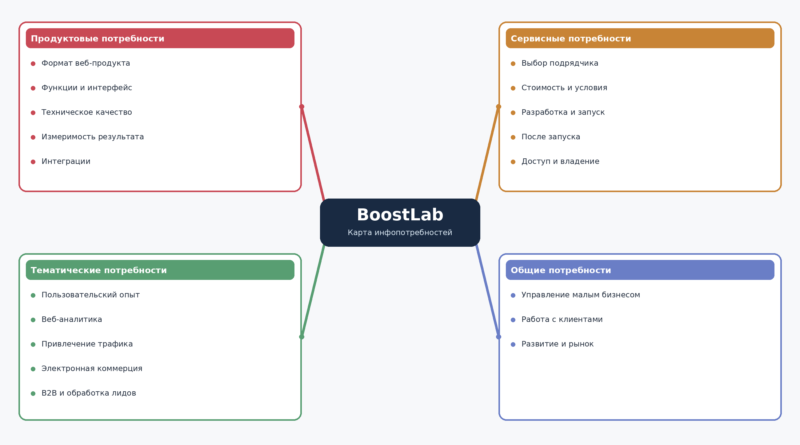

# Лабораторная работа № 1. Профайл аудитории и Карты информационных потребностей

[Версия DOCX](lr01-audience-profile.docx)

Цель работы: Изучение правил и особенностей разработки главных документов рекламной стратегии – Аватара клиента и Карты информационных потребностей.

## 1. Теоретические основы разработки Аватара клиента

Целевая аудитория (ЦА) — группы потенциальных покупателей, объединённые сходными задачами и условиями выбора продукта. Социально-демографический портрет описывает возраст, место проживания, занятость, доход и образование; социально-психологический — боли, мотивацию, страхи, ценности, привычки и критерии выбора.

Аватар клиента — рабочая модель типичного представителя отдельного сегмента ЦА. Он помогает определить, кому адресовать рекламный текст, какие потребности и возражения учитывать, где искать аудиторию и как объяснять ценность услуги. Данные для Аватара получают через интервью с клиентами и сотрудниками, анализ обращений, отзывов и профильных сообществ.

Карта информационных потребностей — разветвлённый перечень вопросов аудитории о продукте и вокруг него. Её основные ветви: продуктовые, сервисные, тематические и общие потребности. В отличие от Аватаров отдельных сегментов карта создаётся для продуктовой категории в целом и дополняется по мере появления новых вопросов.

## 2. Компания и сегменты целевой аудитории

BoostLab — веб-студия, специализирующаяся на разработке и развитии сайтов для бизнеса. Основные услуги компании включают создание лендингов, корпоративных сайтов и интернет-магазинов, UX-проектирование, настройку веб-аналитики и оптимизацию после запуска.

В основе позиционирования BoostLab лежит решение конкретных бизнес-задач: привлечение клиентов, увеличение онлайн-продаж и повышение эффективности сайта. Поэтому компания предлагает не только разработку веб-продукта, но и инструменты для оценки результатов его работы.

Основная целевая аудитория BoostLab — малый бизнес, которому необходим функциональный сайт, но нецелесообразно содержать собственную команду веб-разработки. В первую очередь это компании, уже использующие интернет для привлечения клиентов или планирующие развивать онлайн-продажи. Средний бизнес рассматривается как дополнительный сегмент при наличии соответствующих задач и бюджета. Крупные предприятия со сложной ИТ-инфраструктурой не входят в приоритетную аудиторию студии.

Целевая аудитория сегментирована по характеру бизнес-задач, решаемых с помощью веб-продукта. Выделены три основных сегмента:

- Малый бизнес в сфере услуг. Мастерские, ремонтные компании и другие сервисные организации. Основная потребность — получение заявок и звонков с сайта, контроль эффективности рекламы. Типичный заказчик — собственник бизнеса.
- Малый торговый бизнес. Небольшие магазины и локальные бренды, развивающие собственные онлайн-продажи. Основная потребность — интернет-магазин с каталогом, оплатой, учётом заказов и аналитикой. Типичный заказчик — владелец магазина или бренда.
- Малый B2B-бизнес. Поставщики оборудования, материалов и других товаров для организаций. Основная потребность — корпоративный сайт-каталог с подробным представлением продукции, получением запросов на коммерческие предложения и передачей заявок в CRM. Типичный заказчик — собственник или руководитель коммерческого направления.

Для каждого сегмента разработан отдельный Аватар клиента.

## 3. Разработка Аватаров клиентов

### Аватар № 1 — Владелец малого бизнеса в сфере услуг

Сегмент ЦА: собственники небольших компаний, предоставляющих услуги населению и организациям, самостоятельно участвующие в управлении бизнесом.

*Таблица 1 — Аватар № 1*

| Характеристика | Описание |
| --- | --- |
| Имя | Игорь / Мария |
| Возраст | 45 лет (основной диапазон сегмента — 35–55 лет). |
| Страна / город проживания | Россия, Казахстан, Беларусь, страны Балтии (Латвия, Литва, Эстония). |
| Семейное положение | Женат, есть ребёнок. |
| Род деятельности | Владелец малого бизнеса в сфере услуг: автосервис, мастерская по ремонту бытовой техники, ремонтно-строительная компания, клининговая служба, ателье, типография, компания по грузоперевозкам или другой локальный сервис. Лично участвует в управлении компанией. |
| Доход (в месяц) | Нестабильный личный доход, зависящий от прибыли компании после обязательных расходов. Может значительно различаться от месяца к месяцу. |
| Образование | Среднее профессиональное или высшее. Специальность может соответствовать направлению бизнеса. |
| Боли | непрозрачность привлечения клиентов: непонятно, какие рекламные каналы приносят обращения, а какие расходуют бюджет без результата; нестабильная загрузка: периоды нехватки заказов сменяются наплывом клиентов, с которым сотрудники не всегда справляются; потеря потенциальных клиентов из-за пропущенных звонков, необработанных сообщений, неудобной записи или отсутствия обратной связи; нехватка времени на управление, продвижение и развитие бизнеса из-за постоянного решения текущих проблем; усталость и эмоциональное выгорание из-за высокой ответственности, финансовой неопределённости и недостатка времени на семью; сложности с обработкой отзывов и жалоб, отсутствие понятного механизма выявления и устранения повторяющихся проблем; высокие текущие расходы и необходимость иногда снижать цены или нести дополнительные затраты ради удержания клиентов; зависимость от квалифицированных сотрудников, сложности с их загрузкой, мотивацией и удержанием; зависимость от сарафанного радио и сомнения в целесообразности интернет-рекламы; ограниченность средств на развитие: большая часть доходов уходит на поддержание текущей деятельности. |
| Оперативные задачи | снизить личную операционную нагрузку за счёт автоматизации повторяющихся задач и делегирования; наладить учёт заявок и определить эффективность используемых рекламных каналов; сократить потери обращений между первым контактом клиента и оформлением заказа; упростить онлайн-запись, обработку сообщений и передачу заявок сотрудникам; сделать загрузку сотрудников более предсказуемой и сократить периоды простоя; улучшить работу с отзывами и повторными обращениями клиентов; оценить, оправдывают ли расходы на интернет-продвижение получаемые заказы; получить понятные инструменты, которыми сотрудники смогут пользоваться без постоянного участия собственника. |
| Глобальные мечты | создать устойчивый бизнес, способный работать без постоянного личного контроля; передать текущие операции сотрудникам и сосредоточиться на развитии компании и поиске партнёров; расширить бизнес, увеличить прибыль и сформировать финансовую независимость; обеспечить семье высокий уровень жизни и дать ребёнку хорошее образование; иметь достаточно свободного времени для семьи, отдыха и собственного здоровья; создать компанию с хорошей репутацией, которую клиенты рекомендуют другим; стать одним из наиболее востребованных поставщиков услуг в своей нише. |
| Страхи | разорение и потеря основного источника дохода семьи; постоянный рост расходов, налогов, стоимости материалов и заработной платы; уход квалифицированных сотрудников и постоянных клиентов к конкурентам; снижение спроса и неспособность бизнеса адаптироваться к изменениям рынка; потеря обращений из-за технических сбоев сайта или системы записи; утечка клиентских данных, взлом сайта, потеря доступа к домену и связанным сервисам; финансовые и юридические последствия серьёзных ошибок, претензий клиентов или нарушения обязательств; профессиональное и личное выгорание, ухудшение здоровья из-за переработок; ухудшение отношений с семьёй из-за постоянного отсутствия дома; многолетняя работа на пределе возможностей без существенного развития бизнеса. |
| Какие шаги предпринимает, чтобы избавиться от болей и страхов, решить задачи? | пытается планировать рабочее время, расходы и загрузку сотрудников; нанимает администраторов, менеджеров или других специалистов для передачи части обязанностей; использует таблицы, программы учёта, CRM и сервисы онлайн-записи; осваивает их самостоятельно; пробует автоматизировать отдельные задачи с помощью ИИ, но сталкивается с ограничениями собственных технических знаний; заказывает простой сайт, пробует контекстную рекламу или самостоятельно ведёт социальные сети; продолжает использовать рекомендации знакомых и постоянных клиентов как способ продвижения; изучает сайты, цены, предложения и организацию обслуживания у конкурентов; читает материалы о рекламе, смотрит обучающие видео, обращается за советами к другим предпринимателям; пробует самостоятельно изменять сайт или просит помощи у знакомых с техническими знаниями; ищет подрядчиков, способных настроить сайт, аналитику и необходимые интеграции без его постоянного участия; сокращает необязательные расходы, чтобы выделить средства на сотрудников, автоматизацию и развитие. |
| Что раздражает и сердит? | необходимость разбираться в сложных технических и рекламных инструментах вместо управления бизнесом; подрядчики, которые критикуют предыдущих исполнителей, но сами не могут объяснить ожидаемый результат; непрозрачные условия сотрудничества, дополнительные платежи и непредсказуемые расходы; срыв сроков, отсутствие обратной связи и нежелание исполнителей брать ответственность за свою работу; непонятные объяснения, профессиональный жаргон, общие обещания без конкретики; высокая стоимость услуг без понятного обоснования; постоянное подорожание материалов, аренды и других обязательных расходов; недовольство сотрудников, особенно когда компания и так испытывает финансовые трудности; истории чужого лёгкого успеха на фоне собственных затяжных проблем; непонимание со стороны близких, которым не хватает его внимания и времени. |
| Жизненные ценности | семья; финансовая стабильность; безопасность; здоровье; самостоятельность и свобода; успех и профессиональная репутация; ответственность за своё дело и сотрудников. |
| Манера общения | Не имеет значения. |
| На каких площадках потребляет профессиональную / познавательную / развлекательную / новостную информацию | социальные сети и мессенджеры: Telegram, ВКонтакте; Instagram и Facebook; видео: YouTube, Rutube — профессиональные обзоры, интервью с предпринимателями, обучение; деловые и новостные СМИ: РБК, «Ведомости», «Коммерсантъ», региональные издания; профессиональные ресурсы: отраслевые сайты, форумы и сообщества по своему направлению деятельности; материалы о бизнесе: Контур.Журнал, Т—Бизнес секреты, VC.ru, «Мой бизнес»; официальная информация: сайты ФНС, государственных и региональных организаций поддержки предпринимательства; личные контакты: общение с другими предпринимателями, поставщиками и участниками отраслевых мероприятий. |
| Топ интересующих тем | экономика, законодательство и политика, влияющие на предпринимательство; развитие и управление малым бизнесом; профессиональные технологии, оборудование и материалы своей отрасли; привлечение и удержание клиентов; реклама и продвижение услуг; автоматизация и сокращение операционной нагрузки; управление сотрудниками и финансами; семья, отдых, здоровье и личные интересы. |
| Какую роль в жизни Клиента играет Ваш продукт? | Периодическое приобретение услуги с дальнейшим самостоятельным использованием веб-продукта. BoostLab разрабатывает сайт, настраивает необходимую аналитику и интеграции, помогает с запуском, исправляет выявленные недостатки и передаёт доступы и инструкции. В дальнейшем клиент может самостоятельно работать с системой, при необходимости обращаясь за консультациями или отдельными доработками. |
| Уровень осведомленности клиента о продукте | Крайне низкий. |
| Принимает ли решение рационально или эмоционально? | Преимущественно рационально. Эмоциональный фактор усиливается при накоплении проблем, усталости или неудач с предыдущими подрядчиками. |
| Кто принимает решение о покупке? | Самостоятельно, как собственник бизнеса. |
| Критерии выбора Продукта | стоимость и прозрачность формирования цены; соответствие решения конкретным задачам бизнеса; понятные сроки и этапы работы; компетентность подрядчика, наличие портфолио и релевантных кейсов; возможность оценивать результат работы сайта; понятные гарантии на выполненные работы и условия исправления ошибок; передача доступов и возможность самостоятельного использования продукта; наличие консультаций и технической поддержки после запуска; простота объяснений и доверие к менеджеру проекта. |
| Возражения при покупке | высокая стоимость разработки и настройки; отсутствие свободных средств на очередное улучшение; недоверие к подрядчикам после предыдущего неудачного опыта; сомнения в необходимости нового решения: существующие способы привлечения клиентов всё ещё работают; неуверенность в том, что сайт и аналитика принесут ощутимую пользу; непонимание, почему нельзя решить задачу самостоятельно или с помощью недорогого конструктора и ИИ; опасения дополнительных платежей, технических проблем и зависимости от исполнителя; отсутствие времени на участие в разработке и освоение новых инструментов; сомнения в предоставляемых гарантиях и дальнейшей поддержке. |

### Аватар № 2 — Владелец малого торгового бизнеса

Сегмент ЦА: собственники небольших торговых компаний и брендов, продающих товары через маркетплейсы, собственные интернет-магазины и другие каналы.

*Таблица 2 — Аватар № 2*

| Характеристика | Описание |
| --- | --- |
| Имя | Василий / Елена |
| Возраст | 43 года (основной диапазон сегмента — 35–55 лет). |
| Страна / город проживания | Россия, Казахстан, Беларусь, страны Балтии (Латвия, Литва, Эстония) |
| Семейное положение | Замужем, детей нет |
| Род деятельности | Владелец малого торгового бизнеса. Основные направления: собственное производство товаров; закупка и перепродажа товаров отечественных и зарубежных поставщиков; продажа товаров под собственным брендом с привлечением сторонних производителей. Реализует продукцию через маркетплейсы, собственный интернет-магазин и другие каналы. |
| Доход (в месяц) | Нестабильный личный доход, зависящий от прибыли бизнеса. Существенно меняется в зависимости от объёма продаж, закупочных цен, комиссий, логистических расходов и сезонности. |
| Образование | Не имеет значения. |
| Боли | высокие комиссии маркетплейсов, расходы на хранение, доставку, продвижение и возвраты, снижающие прибыль; зависимость от правил и алгоритмов торговых площадок, непрозрачность отдельных начислений и изменение условий сотрудничества; сложности с прогнозированием спроса: одни товары заканчиваются слишком быстро, другие надолго остаются на складе, замораживая оборотные средства; необходимость вручную обновлять ассортимент, цены и остатки в нескольких каналах продаж; ошибки в работе собственного интернет-магазина: проблемы с оформлением заказов, онлайн-оплатой, обратной связью и отображением остатков; отсутствие единой аналитики продаж по маркетплейсам, собственному сайту и другим каналам; сложности с отслеживанием повторных покупок и формированием собственной базы постоянных клиентов; негативные отзывы из-за задержек доставки, повреждений товаров и других обстоятельств, не всегда зависящих от продавца; высокая конкуренция и необходимость постоянно снижать цены или участвовать в акциях для сохранения продаж; недостаток времени на развитие бизнеса из-за закупок, обработки заказов, общения с клиентами и решения текущих проблем; эмоциональное выгорание, финансовая нестабильность и недостаточная поддержка предпринимательской деятельности со стороны близких. |
| Оперативные задачи | сформировать устойчивую торговую компанию с понятными процессами и контролируемыми финансовыми показателями; развивать собственный интернет-магазин как дополнительный канал продаж и снижать зависимость от маркетплейсов; обеспечить стабильную работу каталога, корзины, онлайн-оплаты и оформления заказов; автоматизировать обновление цен, ассортимента и остатков на разных площадках; наладить учёт заказов и интеграцию интернет-магазина с CRM и складской системой; анализировать спрос и планировать закупки или производство с учётом сезонности и динамики продаж; определить наиболее прибыльные товары и каналы продаж с учётом всех сопутствующих расходов; упростить работу с отзывами, обращениями и повторными покупками; сократить ручной труд и освободить время для развития бренда и личной жизни. |
| Глобальные мечты | создать собственный узнаваемый бренд, которому доверяют покупатели; превратить небольшой торговый бизнес в устойчивую компанию с постоянными клиентами и собственными каналами продаж; расширить ассортимент и географию продаж, в перспективе выйти на международный рынок; добиться финансовой независимости и высокого уровня жизни; передать рутинные операции сотрудникам и сосредоточиться на создании новых продуктов и развитии бизнеса; получить профессиональное признание, стать известной в своей нише; иметь достаточно свободного времени для путешествий, семьи, отдыха и личных интересов; реализовать собственные идеи и чувствовать гордость за созданное дело. |
| Страхи | разорение и потеря вложенных в бизнес средств; вытеснение с рынка крупными брендами и продавцами, способными предлагать более низкие цены; повышение комиссий маркетплейсов и других расходов до уровня, при котором продажи перестанут приносить прибыль; скопированные конкурентами товары или идеи собственного бренда; срыв поставок, потеря или повреждение крупной партии товаров; накопление непроданных остатков, нехватка оборотных средств для новых закупок; массовые негативные отзывы, снижение рейтинга продавца и потеря доверия покупателей; технические сбои, потеря заказов, данных клиентов или доступа к собственному интернет-магазину; неспособность адаптироваться к развитию технологий и изменению покупательских привычек; не реализовать собственный потенциал и разочаровать близких, не верящих в успех бизнеса; потратить годы на постоянную работу без финансовой стабильности и свободного времени. |
| Какие шаги предпринимает, чтобы избавиться от болей и страхов, решить задачи? | продаёт товары через маркетплейсы, сравнивает их тарифы и условия сотрудничества; заказывает простой интернет-магазин или пробует создать его самостоятельно с помощью конструктора; пользуется таблицами, личными кабинетами маркетплейсов и сервисами аналитики для контроля продаж; изучает спрос, ассортимент, цены и рекламные стратегии конкурентов; пробует разные способы продвижения: рекламу на маркетплейсах, контекстную рекламу, социальные сети, сотрудничество с блогерами; ищет новых поставщиков, сравнивает закупочные цены и условия доставки; пытается автоматизировать учёт товаров и заказов с помощью готовых сервисов и инструментов ИИ; самостоятельно обновляет карточки товаров, фотографии, описания и цены; обращается за советами к другим продавцам, изучает профильные сообщества и обучающие материалы; рассматривает привлечение сотрудников или подрядчиков для обработки заказов, продвижения и технического обслуживания сайта; пробует программы лояльности, скидки и персональные предложения для увеличения повторных покупок; пытается планировать закупки и расходы, но сталкивается с непредсказуемостью спроса. |
| Что раздражает и сердит? | постоянное повышение комиссий, тарифов и стоимости доставки; принудительное участие в скидочных акциях или изменение условий продаж без достаточного контроля со стороны продавца; негативные отзывы от покупателей, не ознакомившихся с описанием товара или инструкцией; потеря репутации из-за ошибок служб доставки и складов; недостоверные фотографии, в том числе сгенерированные ИИ изображения товаров, которые затрудняют оценку реального качества предложений на рынке; покупатели, оформляющие заказы без намерения выкупить товар, и необоснованные возвраты; необходимость выполнять одни и те же действия вручную на нескольких торговых площадках; сбои в работе сервисов, из-за которых теряются заказы или возникают ошибки в остатках; подрядчики, обещающие увеличение продаж без объяснения способов достижения результата; непрозрачная стоимость разработки, скрытые платежи, нарушение сроков и отсутствие ответственности; недооценка предпринимательства со стороны близких и представление о торговле как о лёгком заработке; публичные истории быстрого успеха, не отражающие реальные расходы и трудности ведения бизнеса. |
| Жизненные ценности | независимость и самостоятельность; финансовая стабильность; семья и близкие отношения; свобода и возможность распоряжаться собственным временем; успех и личная самореализация; доверие покупателей и репутация бренда; творчество и возможность создавать что-то своё; профессиональное признание. |
| Манера общения | Не имеет значения. |
| На каких площадках потребляет профессиональную / познавательную / развлекательную / новостную информацию | социальные сети и мессенджеры: Telegram, ВКонтакте; Instagram и Facebook могут использоваться частью аудитории в зависимости от страны проживания; видео: YouTube, Rutube — обзоры товаров, интервью с предпринимателями, материалы о продажах и продвижении; профессиональные ресурсы: блоги и сообщества продавцов Wildberries, Ozon и других маркетплейсов; материалы об электронной торговле: «МойСклад», Data Insight, T—Бизнес секреты, Контур.Журнал, VC.ru; деловые и новостные СМИ: РБК, «Ведомости», «Коммерсантъ», региональные издания; поисковые системы: Яндекс, Google — поиск поставщиков, сервисов, подрядчиков и способов решения проблем; личные контакты: общение с предпринимателями, поставщиками, участниками выставок и профильных мероприятий. |
| Топ интересующих тем | развитие электронной торговли и маркетплейсов; создание и продвижение собственного бренда; покупательские предпочтения, тенденции спроса и востребованные товары; поиск поставщиков, закупки и логистика; реклама, маркетинг и привлечение покупателей; веб-аналитика, автоматизация торговли и управление ассортиментом; финансовое планирование, налоги и законодательство в сфере торговли; экономика и политика, влияющие на предпринимательство; путешествия, семья, здоровье, отдых и личные увлечения. |
| Какую роль в жизни Клиента играет Ваш продукт? | Долгосрочный инструмент продаж и развития собственного бренда. BoostLab разрабатывает интернет-магазин, настраивает необходимые интеграции, оплату и аналитику, помогает с запуском и исправлением выявленных недостатков. После передачи доступов и инструкций клиент может самостоятельно управлять магазином и обращаться за консультациями или отдельными доработками по мере необходимости. |
| Уровень осведомленности клиента о продукте | Низкий или средний. |
| Принимает ли решение рационально или эмоционально? | Преимущественно рационально. Эмоциональная составляющая усиливается при стремлении развивать собственный бренд, избавиться от зависимости от маркетплейсов или после очередных финансовых потерь. |
| Кто принимает решение о покупке? | Самостоятельно, как собственник бизнеса. |
| Критерии выбора Продукта | стоимость разработки и прозрачность ценообразования; соответствие функциональности задачам торгового бизнеса; удобство каталога, поиска, корзины и оформления заказа; возможность интеграции с платёжными, складскими и учётными системами; автоматизация обновления ассортимента, цен и остатков; наличие инструментов аналитики продаж и поведения покупателей; удобство самостоятельного управления интернет-магазином; компетентность подрядчика, портфолио и опыт разработки интернет-магазинов; сроки реализации и понятные этапы работы; гарантии на выполненные работы, исправление технических ошибок и возможность дальнейших консультаций; передача доступов, данных и контроля над веб-продуктом. |
| Возражения при покупке | высокая стоимость разработки и отсутствие свободных средств; сомнения в необходимости собственного интернет-магазина при наличии продаж через маркетплейсы; опасения, что стоимость привлечения покупателей на собственный сайт окажется выше комиссий торговых площадок; неуверенность в способности небольшого магазина конкурировать с маркетплейсами по цене, удобству и доставке; недоверие к подрядчикам и опасения повторных расходов на исправление ошибок; непонимание стоимости интеграций, автоматизации и дальнейших доработок; сомнения в возможности самостоятельно управлять интернет-магазином после запуска; отсутствие времени и сотрудников для работы над новым каналом продаж; неуверенность в том, что новый сайт обеспечит достаточное количество заказов; опасения потерять доступ к сайту, данным или необходимой технической поддержке после завершения сотрудничества. |

### Аватар № 3 — Владелец малого B2B-бизнеса

Сегмент ЦА: собственники небольших компаний, работающих преимущественно с юридическими лицами: производители, оптовые поставщики, дистрибьюторы оборудования, комплектующих, материалов и другой продукции для бизнеса.

*Таблица 3 — Аватар № 3*

| Характеристика | Описание |
| --- | --- |
| Имя | Андрей / Ирина |
| Возраст | 45 лет (основной диапазон сегмента — 35–55 лет). |
| Страна / город проживания | Россия, Казахстан, Беларусь, страны Балтии (Латвия, Литва, Эстония) |
| Семейное положение | Замужем, есть дети. |
| Род деятельности | Владелец малого B2B-бизнеса: оптовые поставки строительных и отделочных материалов, промышленного оборудования, электротехнической продукции, запасных частей, расходных материалов; небольшое производство продукции для других предприятий. Лично участвует в управлении компанией, переговорах с ключевыми заказчиками и развитии продаж. |
| Доход (в месяц) | Нестабильный личный доход, зависящий от прибыли компании. Может существенно различаться в зависимости от объёма заключённых контрактов, рентабельности поставок, отсрочек платежей и текущих обязательств бизнеса. |
| Образование | Среднее профессиональное или высшее, нередко техническое или экономическое. |
| Боли | зависимость от ограниченного числа крупных заказчиков: потеря одного постоянного клиента может существенно повлиять на доход компании; длительный цикл продаж: от первого обращения до заключения договора могут проходить недели или месяцы; сложности с привлечением новых корпоративных клиентов: привычные рекомендации и личные связи не обеспечивают постоянного расширения клиентской базы; неэффективная обработка входящих обращений: заявки поступают через почту, телефон, сайт и мессенджеры, часть теряется или остаётся без ответа; большое количество нецелевых запросов, которые отнимают время менеджеров, но редко приводят к сделке; длительная ручная подготовка коммерческих предложений, подбор продукции и согласование индивидуальных условий поставки; сложности с поддержанием актуальных каталогов, технических характеристик, цен, остатков и сроков поставки; отсутствие единой системы учёта обращений и истории переговоров с заказчиками; недостаточная прозрачность воронки продаж: сложно определить, на каком этапе и по какой причине потенциальные клиенты отказываются от сотрудничества; невозможность точно оценить, какие рекламные каналы приводят не просто заявки, а клиентов, заключающих прибыльные контракты; сложности с планированием закупок и денежных поступлений из-за неравномерности заказов и отсрочек оплаты; высокая зависимость от опытных менеджеров, которые хранят значительную часть информации о клиентах и договорённостях у себя; нехватка времени на развитие компании из-за постоянного участия в переговорах, согласованиях и решении текущих проблем; финансовая неопределённость и эмоциональное выгорание из-за высокой ответственности перед сотрудниками, поставщиками и заказчиками. |
| Оперативные задачи | увеличить количество новых корпоративных заказчиков и снизить зависимость от нескольких крупных клиентов; создать или улучшить корпоративный сайт-каталог с понятной структурой ассортимента, техническими характеристиками и условиями сотрудничества; организовать удобную отправку запросов на коммерческие предложения, расчёт стоимости и консультацию; сократить время на обработку типовых обращений и подготовку коммерческих предложений; настроить передачу заявок с сайта в CRM и сохранение истории взаимодействия с заказчиками; автоматизировать обновление каталога, цен и остатков там, где это возможно и экономически оправданно; разделять целевые и нецелевые обращения, чтобы менеджеры сосредоточились на перспективных сделках; определить эффективность рекламных каналов с учётом качества заявок и заключённых договоров; улучшить взаимодействие отдела продаж, склада, бухгалтерии и других участников процесса обработки заказа; снизить зависимость бизнеса от личного участия собственника и отдельных сотрудников. |
| Глобальные мечты | создать устойчивую компанию с постоянным потоком корпоративных заказчиков и долгосрочными контрактами; стать одним из ведущих поставщиков или производителей в своей отрасли; расширить географию поставок, выйти на новые региональные и международные рынки; создать собственный узнаваемый бренд, ассоциирующийся с надёжностью и профессионализмом; выстроить систему продаж, не зависящую от личных связей владельца и отдельных менеджеров; передать операционное управление профессиональной команде и сосредоточиться на развитии бизнеса и партнёрских отношений; обеспечить финансовую независимость и стабильное будущее своей семье; иметь возможность больше времени уделять семье, путешествиям, здоровью и личным интересам; оставить после себя успешное дело с хорошей репутацией. |
| Страхи | потеря крупнейших заказчиков и значительной части выручки; разорение из-за срыва крупных контрактов, неоплаченных поставок или нехватки оборотных средств; вытеснение с рынка более крупными поставщиками с широким ассортиментом и выгодными условиями; рост закупочных цен, транспортных расходов и других обязательных затрат; срыв сроков поставки и последующая потеря доверия корпоративных клиентов; уход опытного менеджера вместе с ключевыми клиентами и информацией о текущих сделках; потеря перспективных заказчиков из-за несвоевременного ответа, ошибки в коммерческом предложении или технического сбоя; утечка коммерческой информации и персональных данных, взлом корпоративных систем или потеря доступа к сайту; финансовые и юридические последствия невыполненных договорных обязательств; вложение средств в автоматизацию, которая не упростит работу или окажется слишком сложной для сотрудников; технологическое отставание от конкурентов и неспособность компании развиваться; постоянная личная вовлечённость в работу, профессиональное выгорание и нехватка времени на семью. |
| Какие шаги предпринимает, чтобы избавиться от болей и страхов, решить задачи? | поддерживает действующие отношения с постоянными заказчиками и ищет новых через рекомендации, отраслевые мероприятия и личные контакты; участвует в профильных выставках, конференциях и встречах с потенциальными партнёрами; изучает предложения и сайты конкурентов, сравнивает ассортимент, цены и условия сотрудничества; вазмещает информацию о компании и товарах в отраслевых каталогах и на специализированных торговых площадках; заказывает корпоративный сайт или самостоятельно создаёт простой сайт с информацией о компании и продукции; использует Excel, электронную почту, мессенджеры и CRM для ведения клиентской базы и контроля сделок; пытается наладить обмен данными между сайтом, CRM и учётной системой; поручает менеджерам вручную обновлять прайс-листы, составлять коммерческие предложения и отслеживать переговоры; пробует использовать ИИ для подготовки типовых документов, описаний товаров и коммерческих предложений; обращается за советами к другим предпринимателям, поставщикам, отраслевым специалистам и знакомым с техническими знаниями; изучает возможности автоматизации продаж, сравнивает CRM, CMS и готовые B2B-решения; рассматривает привлечение веб-студии или интегратора для разработки каталога и автоматизации обработки заявок; пытается делегировать текущие задачи руководителю продаж и другим сотрудникам. |
| Что раздражает и сердит? | длительные согласования и отсутствие определённости со стороны потенциальных заказчиков; клиенты, которые неоднократно запрашивают расчёты и коммерческие предложения, но не сообщают о принятом решении; попытки заказчиков добиться максимальных скидок без учёта себестоимости и условий поставки; постоянное изменение цен и сроков поставок у производителей и поставщиков; ошибки сотрудников в документах, расчётах и передаче информации между отделами; невозможность быстро получить актуальные сведения о клиенте или состоянии сделки; необходимость неоднократно вводить одни и те же данные в разные программы; подрядчики, предлагающие универсальные шаблонные решения без понимания особенностей B2B-продаж; излишнее внимание веб-студий к дизайну при недостаточном понимании задач отдела продаж; непрозрачные сметы, скрытые платежи и неожиданно возникающая стоимость интеграций; нарушение сроков, отсутствие ответственности за технические ошибки и непонятные объяснения; обещания автоматизировать все процессы без предварительного изучения работы компании; недостаток личного времени и постоянная необходимость решать проблемы, которые должны быть делегированы сотрудникам. |
| Жизненные ценности | семья и благополучие близких; финансовая стабильность и безопасность; самостоятельность и свобода; профессионализм и компетентность; ответственность за обязательства;  надёжность и долгосрочное партнёрство; деловая репутация; успех и профессиональное признание; развитие и независимость бизнеса. |
| Манера общения | Не имеет значения. |
| На каких площадках потребляет профессиональную / познавательную / развлекательную / новостную информацию | социальные сети и мессенджеры: Telegram, ВКонтакте, отраслевые сообщества и чаты поставщиков; видео: YouTube, Rutube — интервью с предпринимателями, обзоры оборудования и профессиональные материалы; деловые и новостные СМИ: РБК, «Ведомости», «Коммерсантъ», отраслевые и региональные издания; профессиональные ресурсы: сайты производителей, дистрибьюторов, отраслевые порталы, ассоциации и специализированные форумы; материалы о бизнесе: Контур.Журнал, T—Бизнес секреты, VC.ru, «Мой бизнес»; торговые площадки: B2B-каталоги, электронные торговые площадки и сервисы поиска поставщиков; поисковые системы: Яндекс, Google — поиск оборудования, партнёров, программного обеспечения и подрядчиков; личное общение: отраслевые выставки, конференции, переговоры с поставщиками и другими предпринимателями. |
| Топ интересующих тем | развитие B2B-продаж и привлечение корпоративных заказчиков; отраслевые технологии, оборудование, материалы и инновации; поиск поставщиков и развитие партнёрских отношений; оптовая торговля, производство, логистика и управление поставками; управление продажами, CRM и автоматизация коммерческих процессов; электронные каталоги, корпоративные сайты и B2B-платформы; маркетинг, веб-аналитика и оценка эффективности привлечения клиентов; финансовое планирование, налоги и законодательство в сфере предпринимательства; экономика, международная торговля и политика, влияющие на отрасль; семья, здоровье, отдых и личные увлечения. |
| Какую роль в жизни Клиента играет Ваш продукт? | Долгосрочный инструмент привлечения и обслуживания корпоративных заказчиков. BoostLab разрабатывает корпоративный сайт или сайт-каталог, настраивает формы запросов, аналитику и необходимые интеграции, помогает с запуском и исправлением выявленных недостатков. После передачи доступов и инструкций клиент может самостоятельно управлять сайтом, при необходимости обращаясь за консультациями или отдельными доработками. |
| Уровень осведомленности клиента о продукте | Низкий или средний. |
| Принимает ли решение рационально или эмоционально? | Преимущественно рационально. Эмоциональный фактор проявляется в доверии к подрядчику, опасениях за репутацию компании и усталости от неэффективных процессов. |
| Кто принимает решение о покупке? | Окончательное решение принимает самостоятельно как собственник бизнеса. При выборе решения может учитывать мнение руководителя отдела продаж, бухгалтера и сотрудника, отвечающего за действующие информационные системы. |
| Критерии выбора Продукта | стоимость разработки и прозрачность формирования сметы; понимание подрядчиком особенностей B2B-продаж и работы с корпоративными заказчиками; возможность создания удобного каталога с техническими характеристиками, документами и фильтрацией; удобство отправки запросов на расчёт стоимости и коммерческие предложения; возможность интеграции с существующей CRM и учётными системами; автоматизация обновления каталога и обработки заявок там, где это необходимо; наличие инструментов аналитики обращений и источников потенциальных заказчиков; простота самостоятельного управления сайтом и обновления информации; компетентность подрядчика, портфолио и наличие релевантных B2B-кейсов; понятные сроки, этапы работы и ответственность исполнителя; безопасность данных, передача доступов и возможность дальнейшего развития сайта; гарантии на выполненные работы, исправление ошибок и возможность последующих консультаций. |
| Возражения при покупке | высокая стоимость разработки и ограниченный бюджет на цифровизацию; сомнения в необходимости нового сайта при наличии постоянных клиентов и работающих каналов продаж; убеждение, что корпоративные заказчики предпочитают личное общение, а не оформление заявок через сайт; неуверенность в том, что сайт сможет приводить достаточно квалифицированных B2B-заявок; опасения, что автоматизация окажется дороже и сложнее, чем существующая ручная работа; непонимание стоимости интеграций с CRM, учётной системой и каталогом товаров; сомнения в способности сотрудников освоить новые инструменты; недоверие к подрядчикам, не имеющим опыта работы с B2B-компаниями; опасения остановки текущих процессов при внедрении нового решения; отсутствие времени на подготовку технического задания, передачу данных и участие в разработке; неуверенность в предоставляемых гарантиях и дальнейшем сопровождении; опасения потери контроля над сайтом, данными и необходимыми интеграциями после завершения сотрудничества. |

## 4. Определение информационных потребностей клиента

Информационные потребности — сведения, необходимые потенциальному клиенту для понимания своей проблемы, оценки предлагаемых решений и выбора исполнителя.

Для разработанных Аватаров выделены четыре категории:

- Продуктовые — информация о характеристиках и возможностях сайтов, разрабатываемых BoostLab: функциональность, адаптивность, скорость загрузки, аналитика.
- Сервисные — информация об условиях сотрудничества: стоимость, сроки, этапы разработки, гарантии и техническая поддержка.
- Тематические — информация по вопросам, связанным с направлением деятельности компании: конверсия, веб-аналитика, оптимизация сайтов, повышение эффективности онлайн-продаж.
- Общие — информация о цифровизации малого бизнеса, планировании бюджета и выборе инструментов для привлечения клиентов.

## 5. Разработка Карты информационных потребностей

Карта представлена в формате mind map: от центра «BoostLab — веб-продукты и услуги» отходят четыре ветви, далее — подразделы и конкретные вопросы потенциальных клиентов (рисунок 1).

#### Рисунок 1 —  рисунок 1

### Продуктовый потребности

#### Формат веб-продукта

*Типы решений:*

- Чем лендинг отличается от корпоративного сайта?
- Когда нужен интернет-магазин, а когда достаточно каталога с запросом КП?
- Можно ли развивать существующий сайт вместо разработки нового?

*Соответствие задаче:*

- Как сайт будет получать заявки для локального сервиса?
- Как B2B-клиент будет находить оборудование и отправлять запрос?
- Как покупатель сможет оплатить заказ без звонка?

#### Функции и интерфейс

*Путь посетителя:*

- Можно ли оставить заявку со смартфона за несколько действий?
- Есть ли фильтры и поиск по каталогу?
- Нужны ли запись, калькулятор или личный кабинет?

*Управление контентом:*

- Смогу ли я изменить цену, услугу или карточку товара самостоятельно?
- Как сотрудники обновляют каталог без разработчика?

#### Техническое качество

*Устройства и скорость:*

- Как сайт работает на телефоне и в разных браузерах?
- Как проверяется скорость загрузки?

*Надёжность:*

- Что произойдёт при ошибке формы или недоступности сайта?
- Как защищены данные клиентов и платежи?

#### Измеримость результата

*События и цели:*

- Какие действия посетителей фиксируются?
- Как отличить просмотры от заявок и заказов?

*Атрибуция:*

- Можно ли увидеть источник заявки?
- Как отслеживать звонки, отправку форм и этапы корзины?

#### Интеграции

*Продажи и учёт:*

- Можно ли передавать заявки и UTM в CRM?
- Как синхронизируются товары и остатки с учётной системой?

*Оплата и доставка:*

- Можно ли подключить онлайн-оплату?
- Как покупатель выбирает доставку и отслеживает заказ?

### Сервисные потребности

#### Выбор подрядчика

*Компетенции:*

- Есть ли опыт в нашей отрасли и похожие задачи?
- Можно ли посмотреть работающие проекты и подтверждённые результаты?

*Прозрачность:*

- Кто ведёт проект и отвечает на вопросы?
- Что входит в техническое задание и договор?

#### Стоимость и условия

*Бюджет:*

- Из чего формируется цена сайта?
- Что оплачивается отдельно: интеграции, хостинг, лицензии?

*Платежи:*

- Предусмотрена ли поэтапная оплата?
- Что происходит при изменении объёма работ?

#### Разработка и запуск

*Этапы:*

- Как согласуются цели, прототип и дизайн?
- Когда проверяются формы, оплата и аналитика?

*Сроки и приёмка:*

- Сколько длится разработка?
- По каким критериям принимается готовый сайт?

#### После запуска

*Поддержка:*

- Кто исправляет ошибки после релиза?
- Как быстро реагируют на критический сбой?

*Развитие:*

- Можно ли заказать A/B-тесты и доработки?
- Как определяется приоритет будущих изменений?

#### Доступ и владение

*Контроль:*

- Кому принадлежат домен, макеты и исходные материалы?
- Какие доступы и документы передаются заказчику?

### Тематические потребности

#### Пользовательский опыт

*Конверсия:*

- Почему посетитель уходит с первого экрана?
- Как форма заявки влияет на число обращений?

*Мобильный UX:*

- Чего ждут пользователи при заказе с телефона?
- Как проверить понятность каталога и навигации?

#### Веб-аналитика

*Показатели:*

- Что такое конверсия, CPL и стоимость заказа?
- Какие показатели сайта важны малому бизнесу?

*Диагностика:*

- Как находить потери на этапах воронки?
- Как проверить, что изменение улучшило результат?

#### Привлечение трафика

*Поиск и реклама:*

- Как связаны SEO и структура сайта?
- Что должно быть готово на сайте перед запуском рекламы?

*Контент:*

- Как полезные страницы помогают клиенту выбрать услугу?
- Как карточки товаров отвечают на вопросы покупателей?

#### Электронная коммерция

*Покупательский путь:*

- Почему бросают корзину?
- Как наличие разных способов оплаты влияет на выбор?

*Повторные продажи:*

- Как сайт помогает возвращать постоянных покупателей?

#### B2B и обработка лидов

*Качество обращений:*

- Какие поля нужны в запросе коммерческого предложения?
- Как маркетинг и продажи договорятся о квалифицированном лиде?

### Общие потребности

#### Управление малым бизнесом

*Делегирование:*

- Как собственнику перестать контролировать каждое обращение?
- Какие процессы можно передать сотрудникам?

*Планирование:*

- Как планировать расходы на развитие без кассовых разрывов?
- Как выбирать задачи при ограниченном бюджете?

#### Работа с клиентами

*Качество сервиса:*

- Почему клиенты не возвращаются после первой покупки?
- Как собирать и обрабатывать обратную связь?

*Репутация:*

- Что делать с негативным отзывом?
- Как сформировать доверие к небольшой компании?

#### Развитие и рынок

*Новые направления:*

- Когда бизнесу стоит выходить в другой регион?
- Как проверить спрос на новую услугу?

*Команда:*

- Как найти сотрудника, которому можно доверить клиентов?
- Как снизить нагрузку на руководителя?
