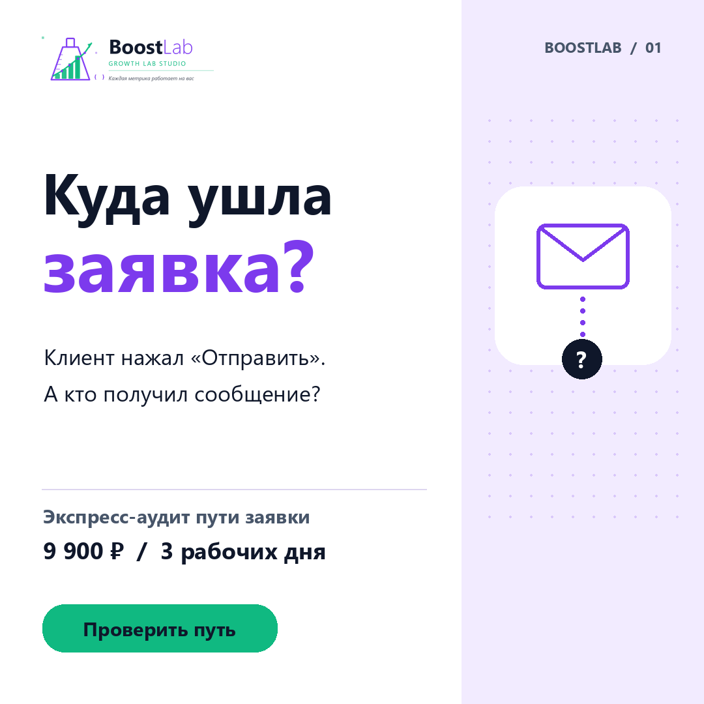
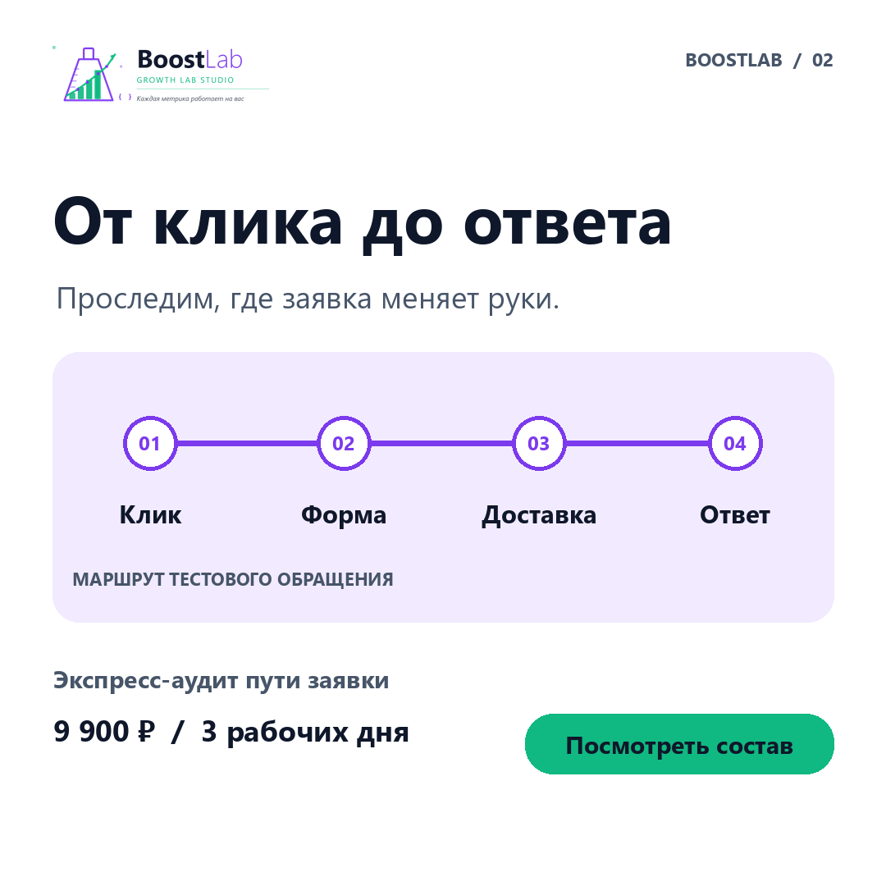
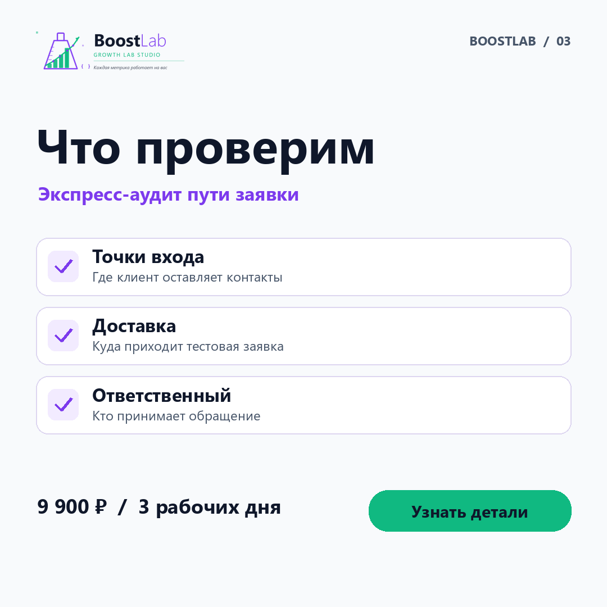
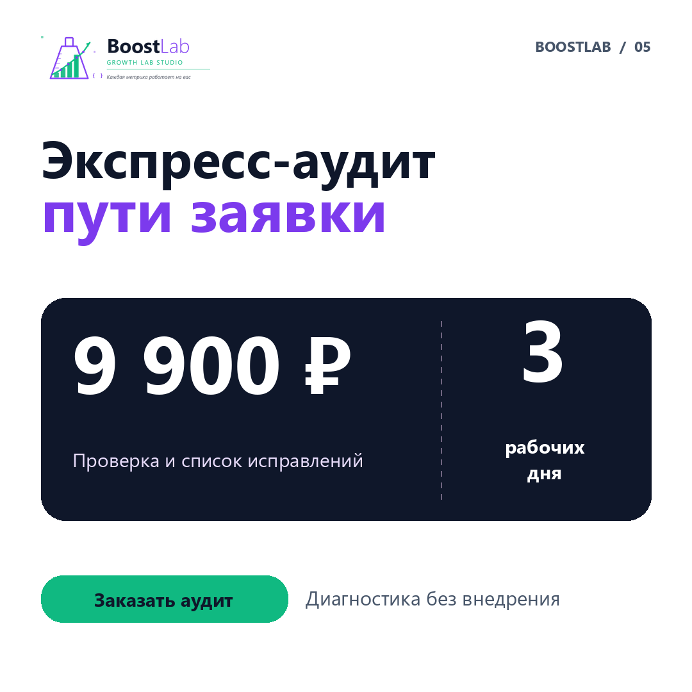

# Лабораторная работа № 8. Создание объявлений таргетированной рекламы

[Версия DOCX](lr08-targeted-ads.docx)

Дисциплина: «Реклама в Интернет». Проект: веб-студия BoostLab.

Цель работы: разработать пять объявлений на одну тему и связать креативы с аудиторией и этапами воронки.

## 1. Таргетинг и воронка

Таргетинг ограничивает показы по заданным признакам. Для первого контакта полезны география, демография и тематические сигналы; ретаргетинг обращается к аудитории, которая уже взаимодействовала с материалами проекта или сайтом. В VK Рекламе можно сочетать настройки аудитории с выбранным местом размещения [1]. В базовом сценарии Telegram Ads выбирают публичные каналы для показа и ведут в канал или бот, а не на внешнюю страницу [2]. Макеты ниже подготовлены для ленты ВКонтакте; это не пять объявлений для разных площадок.

Воронка описывает путь от первого знакомства до заявки. На первом этапе человек узнаёт свою ситуацию, на втором понимает метод проверки, на третьем оценивает условия заказа. Паттерн задаёт, как считывается объявление: крупный вопрос, схема маршрута, чек-лист, сравнение или карточка предложения. Общие правила: одна мысль на макет, читаемый заголовок, один призыв, совпадение обещания с посадочной страницей, никакой выдуманной статистики.

## 2. Задача, аудитория и предложение

Основной сегмент из ЛР № 1: Игорь / Мария, владельцы малого бизнеса в сфере услуг (мастерские, ремонт, клининг). У них уже есть сайт и несколько каналов обращения, но не всегда понятно, дошла ли заявка до администратора. Вторичный сегмент: Андрей / Ирина, малый B2B-бизнес с запросами КП через форму. Для первого теста сегменты не смешиваются. Пять вариантов используют одно учебное предложение из ЛР № 3: экспресс-аудит пути заявки за 9 900 ₽, срок 3 рабочих дня. BoostLab проверяет основные точки обращения, фиксирует проблемы и составляет список исправлений; внедрение не входит. Целевое действие: отправить форму заказа аудита с адресом сайта и рабочим контактом.

## 3. Пять объявлений для ленты ВКонтакте

### 01. «Куда ушла заявка?»

Паттерн: проблемный вопрос и иллюстрация недоставленного сообщения. Первый контакт с владельцами сервисных компаний. Текст объявления: «Клиент нажал “Отправить”, а администратор ничего не увидел? Проверьте маршрут до того, как увеличивать бюджет на рекламу. Экспресс-аудит пути заявки BoostLab: 9 900 ₽, 3 рабочих дня». CTA на макете: «Проверить путь».

### 02. «От клика до ответа»

Паттерн: схема маршрута с узлами. Этап интереса; аудитория, которая уже заметила расхождение между отправками и входящими. Текст объявления: «Пройдём путь клиента по шагам: найдём точку входа, отправим тестовое обращение и проверим, кто его получает. Экспресс-аудит пути заявки: 9 900 ₽, 3 рабочих дня». CTA на макете: «Посмотреть состав».

### 03. «Что проверим»

Паттерн: чек-лист из трёх проверок. Этап сравнения услуг; владельцы, которым нужно понять, что именно они покупают. Текст объявления: «Точки входа, доставка, ответственный. Вместо общей оценки сайта вы получите перечень обнаруженных проблем и порядок исправлений. Экспресс-аудит пути заявки: 9 900 ₽, 3 рабочих дня». CTA на макете: «Узнать детали».

### 04. «Отправлено ≠ получено»

Паттерн: два экрана, на одном подтверждение, на другом нет входящего. Этап осознания проблемы; ситуация подходит также для B2B-формы запроса КП. Текст объявления: «Сообщение “Спасибо” видит клиент, но оно не доказывает, что менеджер получил обращение. Сверим отправку с почтой или CRM. Экспресс-аудит пути заявки: 9 900 ₽, 3 рабочих дня». CTA на макете: «Сверить маршрут». Изображение условное, не скриншот работы клиента.

### 05. «Экспресс-аудит»

Паттерн: карточка предложения с ценой как главным акцентом. Этап решения; посетители страницы услуги, не отправившие форму. Текст объявления: «Если сайт уже принимает обращения, начинать с нового сайта не обязательно. Проверим путь заявки и подготовим список исправлений. Экспресс-аудит пути заявки: 9 900 ₽, 3 рабочих дня». CTA на макете: «Заказать аудит».

## 4. План проверки гипотез

Учебный вариант запуска: одна география для первичного сравнения (например, Россия), оба пола, 35–55 лет как стартовое допущение из аватара, тематические сигналы малого бизнеса и управления сайтом. Отдельная группа ретаргетинга: посетители страницы аудита за 30 дней, исключая отправивших заявку, если аудитория накоплена и настроено событие. Эти параметры не являются результатом исследования.

Чтобы сравнить пять креативов, в первом тесте сохраняем общую аудиторию, плейсмент, посадочную страницу, период и сопоставимые лимиты. Различаются только изображение и соответствующий ему текст; результат относится к объявлению целиком. Размечаем каждое объявление отдельным значением utm_content (lr08_01 … lr08_05). Проверяем событие только после успешной отправки формы и сопоставляем записи с журналом обращений. CTR = клики / показы; конверсия в заявку = подтверждённые заявки / клики; CPL = расход / подтверждённые заявки. CTR показывает интерес, но выбор делаем по CPL и качеству обращений при достаточном объёме; без данных победителя не назначаем.

Результат: созданы пять разных PNG 1080 × 1080 с логотипом BoostLab. Объявления не публиковались; показов, бюджета и результатов теста нет.

## Источники

- ЛР № 1: аватары аудитории; ЛР № 3: текст 1 и учебный оффер; logo.svg и брендбук BoostLab: визуальная основа.
- [1] VK, «Как привлекать клиентов с помощью VK Клипов», слайды о размещении в ленте и таргетингах: https://object2-ac.vk-apps.com/vk-education-0554ff56-27eb-4093-a702-685722cef6d9/media/2a/8f2af5eceb37445180dda50ccf6683d6.pdf
- [2] Telegram, «Telegram Ad Platform Explained»: https://ads.telegram.org/getting-started
