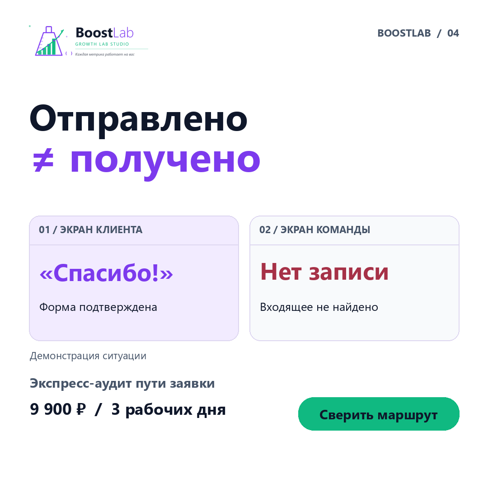

# Лабораторная работа № 8

Таргетированная реклама

Цель работы: Изучение основ таргетинга и принципов разработки таргетированной рекламы.

## 1. Понятие и настройка таргетинга

Таргетинг — механизм интернет-рекламы, позволяющий показывать объявления определённым группам пользователей на основании заданных характеристик.

Основные параметры таргетинга:

- географический — страна, город или район проживания;

- демографический — возраст, пол и другие характеристики аудитории;

- поведенческий — интересы, действия и предпочтения пользователей;

- контекстный — тематика поисковых запросов и потребляемого контента;

- ретаргетинг — повторное обращение к пользователям, ранее взаимодействовавшим с компанией.

Особенности настройки таргетинга в различных социальных сетях

ВКонтакте. Реклама настраивается через платформу VK Реклама. Доступен выбор аудитории по географии, возрасту, полу, интересам и поведению. Можно ориентироваться на пользователей, вводивших определённые поисковые запросы, интересующихся тематическими сообществами, а также на ранее взаимодействовавших с сайтом или рекламой. Для BoostLab целесообразно выделять отдельные аудитории владельцев сервисного, торгового и B2B-бизнеса.

Одноклассники. Для размещения используются рекламные инструменты Одноклассников и VK Реклама. Доступны географические и демографические настройки, интересы, поисковые фразы и аудитории ретаргетинга. Особенность площадки — возможность продвижения сообществ и публикаций непосредственно внутри социальной сети. Для BoostLab её целесообразно рассматривать как дополнительную площадку после проверки присутствия целевой аудитории.

Telegram. В базовом формате Telegram Ads рекламодатель выбирает публичные каналы, в которых будут показываться объявления. В отличие от ВКонтакте, основной принцип настройки заключается не в подробном описании характеристик конкретного пользователя, а в подборе каналов с подходящей аудиторией. Для BoostLab это могут быть каналы о малом бизнесе, предпринимательстве и интернет-маркетинге. Рекламное сообщение ведёт в Telegram-канал или бот; формат и объём текста ограничены правилами платформы.

Таким образом, во ВКонтакте и Одноклассниках основное внимание уделяется настройке характеристик аудитории, а в Telegram — выбору подходящих каналов размещения. Для повышения эффективности рекламы необходимо учитывать особенности площадки и конкретного сегмента ЦА.

## 2. Основные принципы создания объявления таргетированной рекламы

Таргетированная реклама направлена на пользователей, которые могут быть не знакомы с компанией. Поэтому объявление должно быстро привлекать внимание и объяснять ценность предложения.

Основные принципы разработки:

- соответствие целевой аудитории — обращение к конкретным потребностям, проблемам и интересам потенциальных клиентов;

- краткость — минимальная вводная часть и быстрое изложение сути предложения;

- однозначность — одно основное рекламное сообщение в каждом объявлении;

- выразительность — заметное изображение и понятный заголовок;

- аргументированность — конкретная польза, условия предложения и подтверждение заявленных преимуществ;

- призыв к действию — понятное указание следующего шага для пользователя.

Объявление должно соответствовать ограничениям выбранного рекламного формата. Для оценки эффективности разных вариантов используются сравнительные рекламные тесты.

## 3. Воронка продаж в таргетированной рекламе

Воронка продаж — последовательность этапов, которые проходит потенциальный клиент от знакомства с продуктом до совершения покупки.

Основные этапы воронки и особенности построения объявлений:

Осведомлённость. Пользователь ещё не знаком с компанией или не осознаёт проблему. Объявление должно привлечь внимание и показать знакомую ситуацию. Прямой призыв к покупке на этом этапе может быть преждевременным.

Интерес. Пользователь осознаёт проблему и ищет способы её решения. Объявление раскрывает возможные подходы, объясняет пользу продукта и предлагает узнать подробности.

Рассмотрение. Пользователь сравнивает предложения и оценивает условия сотрудничества. В объявлении используются конкретные преимущества, стоимость, состав услуги, кейсы и ответы на возможные возражения.

Решение. Пользователь готов совершить целевое действие. Объявление содержит оффер — конкретное предложение компании с условиями приобретения услуги — и прямой призыв оставить заявку или оформить заказ.

Пример воронки продаж BoostLab

Для продвижения экспресс-аудита пути заявки стоимостью 9 900 рублей можно использовать следующую последовательность:

Осведомлённость: объявления «Куда ушла заявка?» и «Отправлено ≠ получено» показывают возможную потерю обращения после отправки формы и при передаче заявки сотруднику.

Интерес: объявление «От клика до ответа» объясняет, как проверить путь заявки от отправки формы до получения сообщения сотрудником.

Рассмотрение: объявление «Что проверим» показывает состав аудита, перечень проверяемых элементов и ожидаемый результат.

Решение: объявление «Экспресс-аудит» содержит конкретные условия услуги — 9 900 рублей, три рабочих дня — и призыв «Заказать аудит».

Каждое объявление ориентировано на определённую степень готовности клиента к покупке. При этом пользователь не обязательно последовательно увидит все пять вариантов: этап воронки определяется его текущей потребностью и предыдущими взаимодействиями с компанией.

Помимо этапов воронки продаж, необходимо учитывать последовательность восприятия отдельного объявления:

Изображение. Привлекает внимание пользователя.

Тизер. Помогает определить актуальность предложения.

Текст. Раскрывает проблему, преимущества и условия решения.

CTA (Call to Action). Предлагает следующий шаг, соответствующий готовности пользователя к покупке.

Таким образом, эффективное объявление должно учитывать одновременно этап принятия решения и порядок восприятия рекламного сообщения.

## 4. Виды паттернов таргетированной рекламы

Паттерн — шаблон построения рекламного сообщения, определяющий способ привлечения внимания и подачи предложения.

Основные виды паттернов:

- проблемные — обозначение задачи или трудности клиента с последующим предложением решения;

- информационные — предоставление полезных сведений, инструкций, алгоритмов и чек-листов;

- эмоциональные — использование юмора, неожиданных противопоставлений, энергичных формулировок и разрыва шаблона;

- продающие — акцент на УТП, стоимости, специальных предложениях, результатах и условиях покупки;

- социальные — отзывы, кейсы, истории клиентов и личные обращения;

- интерактивные — вопросы, выбор вариантов, игры, опросы и лид-формы (формы для отправки заявки непосредственно из объявления).

Паттерны могут комбинироваться в одном объявлении. Выбор определяется задачей рекламной кампании, особенностями аудитории и этапом воронки продаж.

## 5. Объявления BoostLab

Для продвижения BoostLab разработаны пять объявлений таргетированной рекламы для ленты ВКонтакте. Все варианты рекламируют одну услугу — экспресс-аудит пути заявки стоимостью 9 900 рублей со сроком выполнения три рабочих дня. Объявления различаются паттернами, текстовыми акцентами и визуальным оформлением.

«Куда ушла заявка?» (рисунок 1)

Рисунок 1 – Объявление «Куда ушла заявка?»

Паттерн: проблемный вопрос и иллюстрация недоставленного сообщения. Первый контакт с владельцами сервисных компаний. Текст объявления: «Клиент нажал “Отправить”, а администратор ничего не увидел? Проверьте маршрут до того, как увеличивать бюджет на рекламу. Экспресс-аудит пути заявки BoostLab: 9 900 ₽, 3 рабочих дня». CTA на макете: «Проверить путь».

«От клика до ответа» (рисунок 2)

Рисунок 2 – Объявление «От клика до ответа»

Паттерн: схема маршрута с узлами. Этап интереса; аудитория, которая уже заметила расхождение между отправками и входящими. Текст объявления: «Пройдём путь клиента по шагам: найдём точку входа, отправим тестовое обращение и проверим, кто его получает. Экспресс-аудит пути заявки: 9 900 ₽, 3 рабочих дня». CTA на макете: «Посмотреть состав».

«Что проверим» (рисунок 3)

Рисунок 3 – Объявление «Что проверим»

Паттерн: чек-лист из трёх проверок. Этап сравнения услуг; владельцы, которым нужно понять, что именно они покупают. Текст объявления: «Точки входа, доставка, ответственный. Вместо общей оценки сайта вы получите перечень обнаруженных проблем и порядок исправлений. Экспресс-аудит пути заявки: 9 900 ₽, 3 рабочих дня». CTA на макете: «Узнать детали».

«Отправлено ≠ получено» (рисунок 4)

Рисунок 4 – Объявление «Отправлено ≠ получено»

Паттерн: два экрана, на одном подтверждение, на другом нет входящего. Этап осознания проблемы; ситуация подходит также для B2B-формы запроса КП. Текст объявления: «Сообщение “Спасибо” видит клиент, но оно не доказывает, что менеджер получил обращение. Сверим отправку с почтой или CRM. Экспресс-аудит пути заявки: 9 900 ₽, 3 рабочих дня». CTA на макете: «Сверить маршрут».

«Экспресс-аудит» (рисунок 5)

Рисунок 5 – Объявление «Экспресс-аудит»

Паттерн: карточка предложения с ценой как главным акцентом. Этап решения; посетители страницы услуги, не отправившие форму. Текст объявления: «Если сайт уже принимает обращения, начинать с нового сайта не обязательно. Проверим путь заявки и подготовим список исправлений. Экспресс-аудит пути заявки: 9 900 ₽, 3 рабочих дня». CTA на макете: «Заказать аудит».
