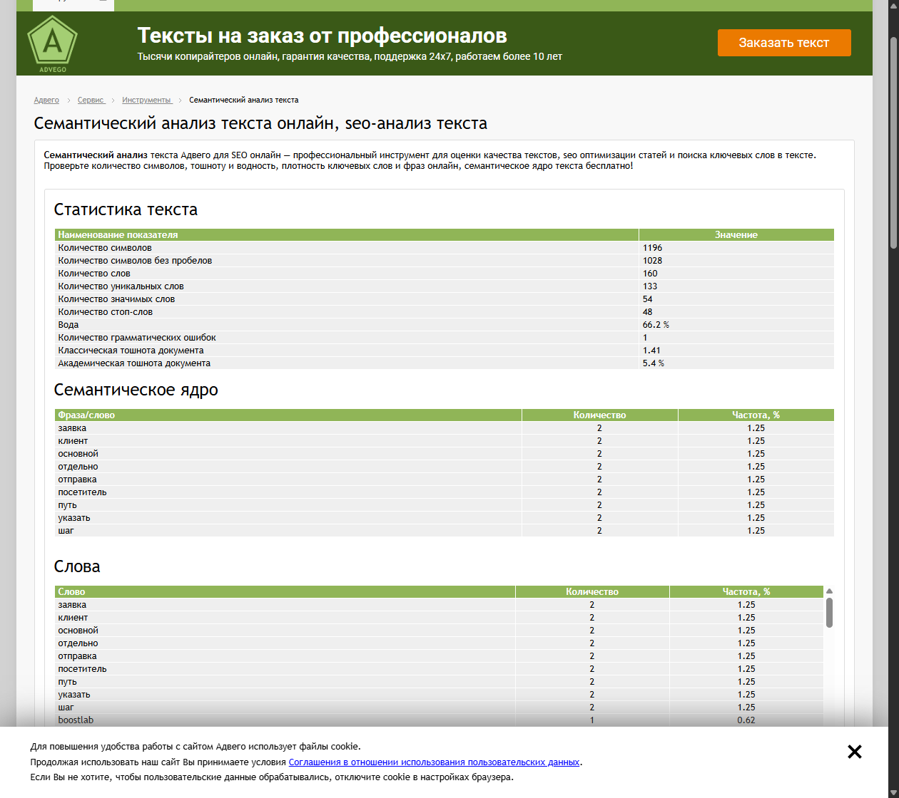

# Лабораторная работа № 10

SEO

Цель работы: Изучение основ SEO-оптимизации и SEO-копирайтинга как основной составляющей SEO-продвижения.

## 1. Понятие SEO

SEO (Search Engine Optimization) - комплекс мероприятий, направленных на повышение видимости сайта в органической выдаче поисковых систем.

SEO-продвижение включает работу со структурой сайта, техническими характеристиками, содержанием страниц, ссылками и пользовательским опытом.

Современное SEO ориентировано прежде всего на соответствие страницы поисковому запросу и потребностям пользователя. Поисковые системы оценивают не только наличие ключевых слов, но и полезность содержания, доступность информации и качество сайта.

SEO-копирайтинг - создание текстов, отвечающих поисковым запросам пользователей с учётом требований поисковых систем. Его основная задача - предоставить посетителю полезную информацию и помочь найти необходимый продукт или услугу.

## 2. Девять шагов современного SEO

SEO-продвижение включает девять основных направлений работы:

Проработка семантического ядра. Сбор и группировка поисковых запросов, по которым потенциальные клиенты могут искать продукт или услугу.

Подбор релевантных страниц. Распределение групп запросов между страницами сайта в соответствии с их содержанием и назначением.

Оптимизация структуры сайта. Создание понятной иерархии разделов, удобной навигации и внутренней перелинковки - системы ссылок между страницами одного сайта.

Проработка внутренних факторов. Оптимизация HTML-разметки, заголовков, метатегов, изображений, скорости загрузки, мобильной версии и доступности страниц для индексации.

SEO-копирайтинг. Написание уникальных, структурированных и содержательных текстов с естественным использованием ключевых запросов.

Работа со ссылочной массой. Получение ссылок с тематически релевантных и авторитетных ресурсов для повышения узнаваемости сайта и доверия к нему.

Работа с поведенческими факторами. Улучшение пользовательского опыта: удобства навигации, поиска информации и взаимодействия с сайтом.

Продвижение в альтернативном поиске. Оптимизация изображений, видео и представления компании на картах и других поисковых сервисах.

Аналитика и повышение конверсии. Отслеживание поискового трафика, запросов, переходов и целевых действий с последующей корректировкой стратегии.

Все перечисленные направления взаимосвязаны и применяются с учётом особенностей конкретного сайта.

## 3. Основные правила SEO-копирайтинга

При создании SEO-текстов необходимо соблюдать следующие правила:

Соответствие поисковому запросу. Текст должен отвечать на вопрос пользователя и соответствовать назначению страницы.

Естественное использование ключевых слов. Поисковые запросы необходимо включать в текст грамматически корректно, без искусственных повторений.

Оптимизация заголовков и метатегов. Основной запрос желательно использовать в заголовке страницы и title - заголовке HTML-документа, отображаемом во вкладке браузера. В подзаголовках запросы используются по смыслу. Description - метаописание, кратко раскрывающее содержание страницы; оно может использоваться в поисковой выдаче.

Логическая структура. Текст необходимо делить на смысловые блоки, используя абзацы, подзаголовки и списки.

Равномерное распределение запросов. Ключевые фразы следует размещать по смыслу, избегая их чрезмерной концентрации в отдельных частях текста.

Уникальность и полезность. Содержание должно представлять самостоятельную ценность для читателя и не сводиться к механическому переписыванию чужих материалов.

Отсутствие переспама. Избыточное повторение слов ухудшает восприятие текста и может отрицательно влиять на его оценку поисковыми системами.

Академическая тошнота текста - показатель частоты повторения слов относительно общего объёма текста, выраженный в процентах. Используется для оценки насыщенности текста повторяющейся лексикой и выявления возможного переспама.

Проверка текста. Перед публикацией необходимо проверить грамотность, соответствие теме, наличие ключевых запросов и показатели SEO-анализа.

В рамках лабораторной работы академическая тошнота текста должна находиться в пределах 4–6 %. Для проверки используется сервис Адвего.

## 4. Проработка семантического ядра

Семантическое ядро - совокупность поисковых запросов, характеризующих тематику сайта и потребности его целевой аудитории.

По частотности запросы подразделяются на высокочастотные, среднечастотные и низкочастотные. По намерению пользователя выделяются информационные, коммерческие и другие виды запросов.

Для формирования семантического ядра используются анализ потребностей аудитории, поисковые подсказки, статистика запросов и изучение конкурентов.

Для страницы услуги экспресс-аудита пути заявки BoostLab выбраны три ключевых запроса. Их назначение и расположение представлены в таблице 1.

Таблица 1 – Семантическое ядро страницы BoostLab

| **Запрос** | **Намерение** | **Место в тексте** |
| --- | --- | --- |
| экспресс-аудит пути заявки | Коммерческое: заказать диагностику | Заголовок блока |
| проверка форм на сайте | Смешанное: понять процедуру или найти специалиста | Абзац о контрольной отправке |
| заявки не доходят до CRM | Информационное: выяснить причину сбоя | Абзац о диагностике маршрута |

Для страницы подготовлены следующие метаданные:

Title: «Экспресс-аудит пути заявки для малого бизнеса \| BoostLab».

Description: «Проверим формы, доставку обращений и передачу ответственному. Отчёт с приоритетами исправлений за 3 рабочих дня. Стоимость 9 900 ₽».

## 5. Написание SEO-текста

На основе выбранных ключевых запросов подготовлен SEO-текст для страницы услуги BoostLab.

Экспресс-аудит пути заявки для малого бизнеса

Клиент оставил контакты, а администратор ничего не получил. Прежде чем увеличивать рекламный бюджет или заказывать редизайн, выясните, на каком шаге пропадает обращение. BoostLab проверит путь от первого клика до передачи сообщения сотруднику.

**Проверка форм на сайте** начинается с контрольной отправки: открываем страницу с телефона, заполняем поля и смотрим, понятно ли посетителю, что произошло после нажатия кнопки. Затем сверяем время отправки с письмом во входящих или строкой в журнале. Отдельно отмечаем, кому приходит уведомление и кто подхватывает диалог, если основной получатель недоступен.

Если **заявки не доходят до CRM**, проверяем согласованный маршрут по шагам. Например, посетитель может увидеть «Спасибо», хотя карточка сделки не появилась. В отчёте укажем точку сбоя, способ воспроизвести проблему и порядок исправлений. Если причина не видна без дополнительного доступа, прямо укажем это в заключении.

Стоимость: 9 900 ₽. Срок: 3 рабочих дня. В цену входит диагностика и список рекомендаций; внедрение обсуждается отдельно. Чтобы заказать аудит, пришлите ссылку и назовите основные каналы, через которые к вам обращаются клиенты.

## 6. Проверка академической тошноты текста

Для оценки частоты употребления слов и ключевых запросов SEO-текст проверен с помощью сервиса Адвего.

19 ноября 2026 года проведена проверка текста вместе с заголовком, без Title и Description. Показатель академической тошноты составил 5,4 %, что соответствует требованиям лабораторной работы.

Результаты проверки:

- объём текста - 1 196 знаков с пробелами;

- объём без пробелов - 1 028 знаков;

- количество слов - 160;

- академическая тошнота - 5,4 %;

- классическая тошнота - 1,41.

Результат проверки представлен на рисунке 1.

Рисунок 1 – Результат проверки SEO-текста в сервисе Адвего
