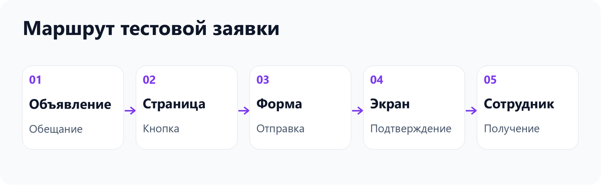

# Лабораторная работа № 11

Яндекс.Дзен и Яндекс.Кью

Цель работы: Изучение дополнительных средств продвижения компании и возможности создания и продвижения собственной экспертности.

Статья сохранена как редакционный черновик. Канал не создан, публикация не проводилась.

## 1. Феномен площадок Яндекс.Дзен и Яндекс.Кью

В материалах курса 2022 года Яндекс.Дзен рассматривается как рекомендательная медиаплатформа. Сегодня Дзен входит в экосистему VK. Помимо подписок, публикации могут находить новых читателей через рекомендации; охват не гарантирован.

Яндекс.Кью был сервисом вопросов и ответов. С 28 июня 2023 года он перешёл в режим чтения, поэтому в план активного продвижения BoostLab его не включаем.

## 2. Работа рекомендательного алгоритма Дзена

Алгоритм Дзена использует машинное обучение для подбора контента каждому конкретному пользователю. При ранжировании публикации система оценивает не только тему, но и поведенческие факторы:

Дочитывания и время на чтение: главные метрики качества текста;

Вовлеченность: комментарии, репосты, лайки/дизлайки;

Переходы по ссылкам: если в статье есть внешние ссылки;

Отписки от канала: негативный сигнал, если материал не оправдал ожиданий читателя, перешедшего по заголовку.

Алгоритм сначала показывает статью узкой тестовой группе. Если метрики положительные — охват расширяется.

## 3. Правила продвижения в Дзене

Отсутствие кликбейта: заголовок и обложка не должны обманывать ожидания. За кликбейт Дзен понижает охваты или банит канал;

Регулярность. Для BoostLab планируем одну публикацию в неделю и сверяем результаты по сопоставимым материалам;

Разнообразие форматов: использование не только лонгридов (статей), но и коротких постов, а также видеороликов;

Работа с комментариями: ответы автора под публикацией повышают вовлеченность и дают сигналы алгоритму о «живом» сообществе;

Качество визуала: собственные схемы, фото и инфографика ценятся выше стоковых изображений.

## 4. Концепция канала

Название: «BoostLab \| Сайт до заявки».

Описание для профиля: «Показываем, как проверить путь клиента от объявления до заявки. Пишем о формах, записи, каталогах и веб-аналитике для малого бизнеса. В каждом разборе есть проверка, которую можно повторить на своём сайте».

Читатели: в первую очередь владельцы сервисных компаний с действующим сайтом и рекламой (Игорь/Мария из ЛР № 1). Отдельные материалы адресованы небольшим магазинам и поставщикам B2B: в первом случае проверяем заказ, во втором — запрос коммерческого предложения. Это рабочие сегменты, а не статистика аудитории Дзена.

Рубрики: «Пройдите сами» (чек-листы), «Где оборвался путь» (разборы сценариев), «Считаем обращения» (аналитика без сложных отчётов). Тон спокойный: показываем симптом, способ проверки и следующий шаг. На старте планируем один материал в неделю. Для аватара — колба из фирменного знака, для обложек — белый фон, фиолетовые заголовки и схемы маршрута.

Выход на заявку: сначала читатель получает полезную проверку, затем при необходимости обращается за экспресс-аудитом пути заявки (9900 ₽/3 рабочих дня). В первом цикле сравниваем показы, открытия и дочитывания сопоставимых статей; при рабочей посадочной странице отдельно считаем переходы и подтверждённые обращения. Цифры появятся только после запуска. Например, если открытий мало, проверить карточку; если открывают, но не дочитывают, смотреть, не затянуто ли вступление. За один цикл меняется один элемент.

Площадки и рекомендации. Дзен подходит для серии материалов в ленте, а Яндекс Кью строился вокруг вопросов и ответов. По материалам команды Дзена рекомендации учитывают интересы и действия пользователя, подписки, тематику и формат материала; точная формула из этого не следует [2]. Начать с органического охвата: выдерживается тема канала и проверяется статистика. Если понадобится платный охват, отдельно рассматривается продвижение статьи и это не будет смешиваться с результатами органического охвата.[2]. Заголовок и обложка обещают ровно то, что есть в статье: пять шагов проверки. В тексте короткие абзацы, подзаголовки, две собственные иллюстрации и подпись к схеме [3].

## 5. Темы для постов

В таблице 1 представлены темы для публикации постов.

Таблица 1 – Пять тем для постов

| **№** | **Заголовок** | **Формат и польза для читателя** |
| --- | --- | --- |
| 1 | Заявок с сайта мало: 5 проверок до увеличения бюджета | Чек-лист владельцу сервиса: пройти маршрут с телефона и найти первый сбой. |
| 2 | Кнопку нажали, а заявки нет: что считать в аналитике | Схема событий: отличить клик, успешную отправку и полученное обращение. |
| 3 | Почему покупатель бросает заказ на странице доставки | Разбор учебного сценария магазина: когда показывать стоимость и сроки доставки. |
| 4 | Как помочь закупщику запросить КП из каталога | Разбор карточки B2B: какие параметры и документы показать до формы. |
| 5 | Когда достаточно починить форму, а когда нужен новый сайт | Сравнение двух решений: как выбрать по масштабу проблемы, а не по возрасту дизайна. |

## 6. Статья для Дзена

Заявок с сайта мало: 5 проверок до увеличения бюджета

Иллюстрация представлена на рисунке 1.

Рисунок 1 – Обложка статьи

Реклама приводит людей на сайт, а новых записей почти нет. Прежде чем добавлять бюджет, откройте объявление на телефоне и попробуйте записаться так, будто впервые видите ваш бизнес. Вам понадобятся ссылка на объявление, тестовый номер и доступ к тому месту, где сотрудники получают заявки.

### Сравните объявление с первым экраном

Если в объявлении обещана «запись на диагностику», на сайте человек должен сразу понять, что он попал на страницу диагностики, а не в общий каталог. Проверьте название услуги, город или район и кнопку записи. В учебном примере объявление мастерской вело на список всех услуг. Первая правка здесь — вести на страницу диагностики. Менять дизайн всего сайта пока незачем.

### Попробуйте начать запись обычным большим пальцем

Откройте страницу через мобильную сеть. Проверьте, не закрывает ли кнопку баннер, видно ли её без долгой прокрутки и понятно ли, чего ждать после нажатия. «Записаться на диагностику» точнее, чем «Подробнее», если кнопка действительно открывает запись.

Иллюстрация представлена на рисунке 2.

Рисунок 2 – Маршрут тестовой заявки

Маршрут тестовой заявки. После формы нужно проверить ещё два места: подтверждение на экране и получение у сотрудника.

### Заполните форму и один раз ошибитесь

Сначала отправьте корректный тест, затем введите неполный телефон. Ошибка должна появиться рядом с нужным полем, а уже заполненные данные не должны исчезнуть. Посмотрите и на сами поля: если адрес нужен только при согласовании выезда, стоит спросить, обязательно ли брать его до первого контакта.

### Дождитесь подтверждения и проверьте получение

После отправки клиенту нужно понять, что запрос принят и что будет дальше. Проверьте, появилась ли тестовая запись в CRM или общей почте, а не только надпись «Спасибо» на экране. Попросите коллегу подтвердить, что он получил уведомление и понимает, кому отвечать. Если на сайте всё получилось, а в CRM пусто, начните с передачи заявки, а не с покупки трафика.

### Сверьте отправку с отчётом

Пометьте тестовую заявку и найдите соответствующее событие в аналитике. Клик по кнопке не заменяет успешную отправку: человек мог не заполнить поле или закрыть форму. Для оценки пути сравнивайте шаги за один период и по одному источнику; тестовые обращения исключайте из рабочих итогов. Если отправки есть, но записей нет, проверьте, что происходит после получения заявки.

Запишите найденное одной строкой: шаг → что случилось → как повторить → кто исправит. Сначала беритесь за сбой, который блокирует запись. После правки повторите тот же тест с телефона и проверьте получение ещё раз.

Если хотите пройти этот маршрут вместе со студией, у BoostLab есть экспресс-аудит пути заявки: проверяем ключевые точки обращения и составляем список исправлений по приоритету. 9900 ₽/3 рабочих дня. Начните с вопроса об аудите: укажите адрес сайта и целевое действие (например, «запись на диагностику»). Рост заявок заранее не обещаем.
