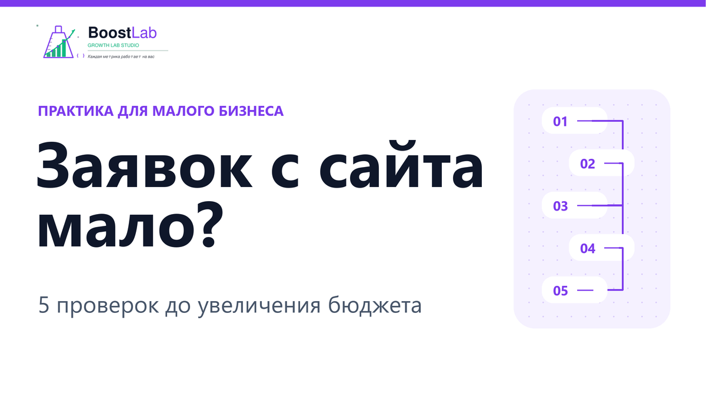

# Лабораторная работа № 11. Канал BoostLab в Дзене

Цель работы: разработать концепцию экспертного канала веб-студии, подготовить пять тем и оформить одну статью. Результат сохранён локально как редакционный черновик; канал и публикация на платформе не создавались.

## 1. Концепция канала

**Название:** «BoostLab | Сайт до заявки».

**Описание для профиля:** «Показываем, как проверить путь клиента от объявления до заявки. Пишем о формах, записи, каталогах и веб-аналитике для малого бизнеса. В каждом разборе есть проверка, которую можно повторить на своём сайте».

**Читатели:** в первую очередь владельцы сервисных компаний с действующим сайтом и рекламой (Игорь / Мария из ЛР № 1). Отдельные материалы адресованы небольшим магазинам и поставщикам B2B: в первом случае проверяем заказ, во втором - запрос коммерческого предложения. Это рабочие сегменты, а не статистика аудитории Дзена.

**Рубрики:** «Пройдите сами» (чек-листы), «Где оборвался путь» (разборы сценариев), «Считаем обращения» (аналитика без сложных отчётов). Тон спокойный: показываем симптом, способ проверки и следующий шаг. На старте планируем один материал в неделю. Для аватара - колба из фирменного знака, для обложек - белый фон, фиолетовые заголовки и схемы маршрута.

**Выход на заявку:** сначала читатель получает полезную проверку, затем при необходимости обращается за экспресс-аудитом пути заявки (9900 ₽ / 3 рабочих дня). В первом цикле сравниваем показы, открытия и дочитывания сопоставимых статей; при рабочей посадочной странице отдельно считаем переходы и подтверждённые обращения. Цифры появятся только после запуска. Например, если открытий мало, проверяем карточку; если открывают, но не дочитывают, смотрим, не затянули ли вступление. За один цикл меняем один элемент.

**Площадки и рекомендации.** Дзен подходит для серии материалов в ленте, а Яндекс Кью строился вокруг вопросов и ответов. Кью перешёл в режим чтения 28 июня 2023 года, поэтому в план распространения не включён [1]. По материалам команды Дзена рекомендации учитывают интересы и действия пользователя, подписки, тематику и формат материала; точная формула из этого не следует [2]. Начинаем с органического охвата: выдерживаем тему канала и проверяем статистику. Если понадобится платный охват, отдельно рассмотрим продвижение статьи и не будем смешивать его результаты с органическими [2]. Заголовок и обложка обещают ровно то, что есть в статье: пять шагов проверки. В тексте короткие абзацы, подзаголовки, две собственные иллюстрации и подпись к схеме [3].

## 2. Пять тем на старт

| № | Заголовок | Формат и польза для читателя |
| --- | --- | --- |
| 1 | Заявок с сайта мало: 5 проверок до увеличения бюджета | Чек-лист владельцу сервиса: пройти маршрут с телефона и найти первый сбой. |
| 2 | Кнопку нажали, а заявки нет: что считать в аналитике | Схема событий: отличить клик, успешную отправку и полученное обращение. |
| 3 | Почему покупатель бросает заказ на странице доставки | Разбор учебного сценария магазина: когда показывать стоимость и сроки доставки. |
| 4 | Как помочь закупщику запросить КП из каталога | Разбор карточки B2B: какие параметры и документы показать до формы. |
| 5 | Когда достаточно починить форму, а когда нужен новый сайт | Сравнение двух решений: как выбрать по масштабу проблемы, а не по возрасту дизайна. |

## 3. Статья для Дзена · локальный черновик

### Заявок с сайта мало: 5 проверок до увеличения бюджета

Реклама приводит людей на сайт, а новых записей почти нет. Прежде чем добавлять бюджет, откройте объявление на телефоне и попробуйте записаться так, будто впервые видите ваш бизнес. Вам понадобятся ссылка на объявление, тестовый номер и доступ к тому месту, где сотрудники получают заявки.

#### 1. Сравните объявление с первым экраном

Если в объявлении обещана «запись на диагностику», на сайте человек должен сразу понять, что он попал на страницу диагностики, а не в общий каталог. Проверьте название услуги, город или район и кнопку записи. В учебном примере объявление мастерской вело на список всех услуг. Первая правка здесь - вести на страницу диагностики. Менять дизайн всего сайта пока незачем.

#### 2. Попробуйте начать запись обычным большим пальцем

Откройте страницу через мобильную сеть. Проверьте, не закрывает ли кнопку баннер, видно ли её без долгой прокрутки и понятно ли, чего ждать после нажатия. «Записаться на диагностику» точнее, чем «Подробнее», если кнопка действительно открывает запись.

*Маршрут тестовой заявки. После формы нужно проверить ещё два места: подтверждение на экране и получение у сотрудника.*

#### 3. Заполните форму и один раз ошибитесь

Сначала отправьте корректный тест, затем введите неполный телефон. Ошибка должна появиться рядом с нужным полем, а уже заполненные данные не должны исчезнуть. Посмотрите и на сами поля: если адрес нужен только при согласовании выезда, стоит спросить, обязательно ли брать его до первого контакта.

#### 4. Дождитесь подтверждения и проверьте получение

После отправки клиенту нужно понять, что запрос принят и что будет дальше. Проверьте, появилась ли тестовая запись в CRM или общей почте, а не только надпись «Спасибо» на экране. Попросите коллегу подтвердить, что он получил уведомление и понимает, кому отвечать. Если на сайте всё получилось, а в CRM пусто, начните с передачи заявки, а не с покупки трафика.

#### 5. Сверьте отправку с отчётом

Пометьте тестовую заявку и найдите соответствующее событие в аналитике. Клик по кнопке не заменяет успешную отправку: человек мог не заполнить поле или закрыть форму. Для оценки пути сравнивайте шаги за один период и по одному источнику; тестовые обращения исключайте из рабочих итогов. Если отправки есть, но записей нет, проверьте, что происходит после получения заявки.

Запишите найденное одной строкой: **шаг → что случилось → как повторить → кто исправит**. Сначала беритесь за сбой, который блокирует запись. После правки повторите тот же тест с телефона и проверьте получение ещё раз.

Если хотите пройти этот маршрут вместе со студией, у BoostLab есть экспресс-аудит пути заявки: проверяем ключевые точки обращения и составляем список исправлений по приоритету. **9900 ₽ / 3 рабочих дня.** Начните с вопроса об аудите: укажите адрес сайта и целевое действие (например, «запись на диагностику»). Рост заявок заранее не обещаем.

## Источники и предпубликационная проверка

[1] Сергей Юдин, руководитель Яндекс Кью. «Кью переходит в режим чтения и становится музеем контента»: https://yandex.ru/q/q/12898949890/

[2] Команда Дзена. «Дзен сегодня», материал VK Education: https://object2-ac.vk-apps.com/vk-education-0554ff56-27eb-4093-a702-685722cef6d9/media/6c/576cd216b19546e79ec138a791705499.pdf

[3] Официальный канал «Дзен для авторов». «Как выглядит идеальная публикация?»: https://t.me/s/zenforcreators/1525

Справка dzen.ru/help при проверке не открылась; для оформления использованы рекомендации официального канала [3]. Перед возможным переносом в Студию сверить актуальные правила и предпросмотр карточки и статьи, подключить согласованный канал связи. Локальный черновик не является черновиком в личном кабинете.
