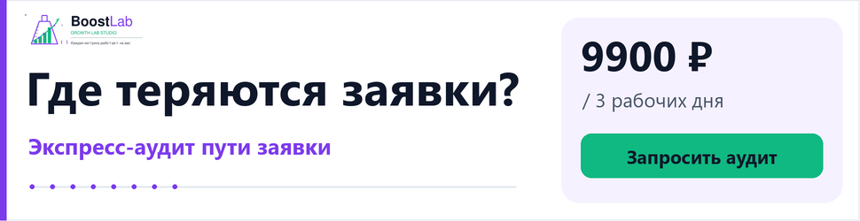
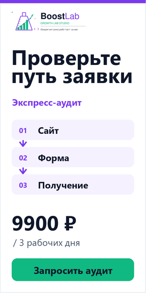

# Лабораторная работа № 13

Визуальный ряд рекламного объявления. Основы фоторекламы

Цель работы: Изучение особенностей композиционного построения рекламного баннера.

Размещения проектные. Утверждённых партнёров и статистики нет.

## 1. Композиция

Композиция (от лат. compositio) – это построение художественного произведения, обусловленное его содержанием, характером и назначением и во многом определяющее его восприятие. В дизайне баннеров это организация элементов (текста, графики, цвета) в единое целое для эффективной передачи сообщения.

## 2. Составляющие композиционного построения

Композиционная форма: формат баннера (горизонтальный, вертикальный), определяющий направление движения взгляда пользователя;

Изобразительные средства: цвет (контраст, акценты), шрифт (размер, начертание, иерархия), графические элементы (линии, фигуры, логотип) и свободное пространство (воздух);

Законы композиции: использованы законы ритма (повторение узлов маршрута), контраста (выделение СВКЦ размером и цветом), нюанса (оттенки фиолетового и изумрудного), а также правила работы с сеткой и выравниванием для управления вниманием.

## 3. Рекламные баннеры BoostLab

Горизонтальный баннер 970 × 250px

На рисунке 1 представлен горизонтальный рекламный баннер.

Рисунок 1 – Горизонтальный баннер

Размещение и ЦА: широкий блок рядом со статьёй о рекламе или CRM на отраслевом сайте. Для владельца сервиса, у которого есть трафик, но неясно, почему мало записей.

Текст на баннере: «Где теряются заявки?»/«Экспресс-аудит пути заявки»/«9900 ₽/3 рабочих дня»/«Запросить аудит».

СВКЦ: вопрос «Где теряются заявки?» визуально выделен размером и контрастом. Горизонтальный макет асимметричен: крупный текст уравновешен блоком цены и кнопки справа. Основные блоки разнесены по сетке и разделены белым полем, поэтому считываются в порядке «проблема → услуга → цена → действие». Логотип подписывает объявление, но не спорит с вопросом.

Вертикальный баннер 300 × 600px

На рисунке 2 представлен вертикальный рекламный баннер.

Рисунок 2 – Вертикальный баннер

Размещение и ЦА: боковая колонка сайта об автоматизации малого бизнеса. Для собственника или маркетолога, которому важна передача заявки с сайта сотруднику.

Текст на баннере: «Проверьте путь заявки»/«Экспресс-аудит»/«Сайт → Форма → Получение» (маршрут в рисунке)/«9900 ₽/3 рабочих дня»/«Запросить аудит».

СВКЦ: крупный двухстрочный заголовок «Проверьте путь заявки». Три узла под ним образуют вертикальный маршрут и ведут взгляд к условиям и кнопке; это схема действий, а не график результатов. Повтор формы узлов задаёт ритм. Белые интервалы отделяют СВКЦ, схему и CTA, а левое выравнивание связывает их в одну колонку.

### Производственные параметры

Использован исходный логотип logo.svg из репозитория. Основные цвета: белый #FFFFFF, фиолетовый #7C3AED, изумрудный #10B981; графит #0F172A для контрастного текста. Изумрудный выделяет действие; логотип не перекрашен. Оба PNG без внешних изображений и без утверждений о гарантированном росте.

Предполагаемая ссылка для обоих форматов - страница экспресс-аудита. На ней должны совпасть название, цена и срок; ссылки и места размещения оформляются после согласования. Для будущей проверки размечаем форматы отдельно и сравниваем показы, переходы и подтверждённые заявки. По одному CTR не делаем вывод о качестве обращений.
