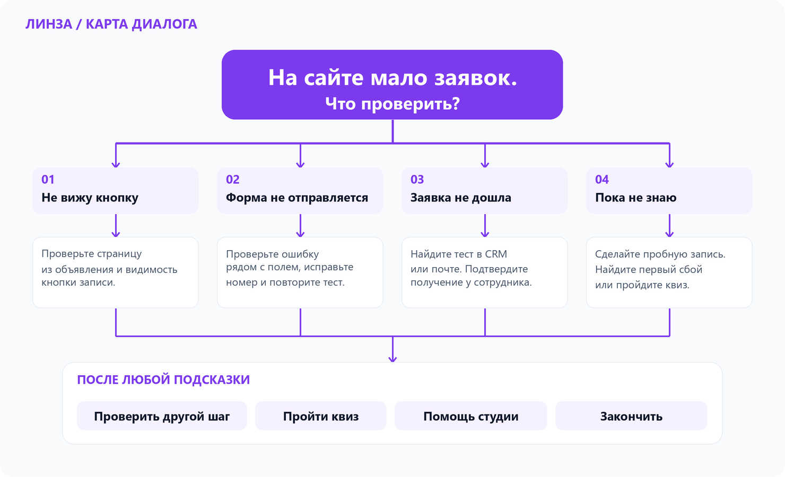
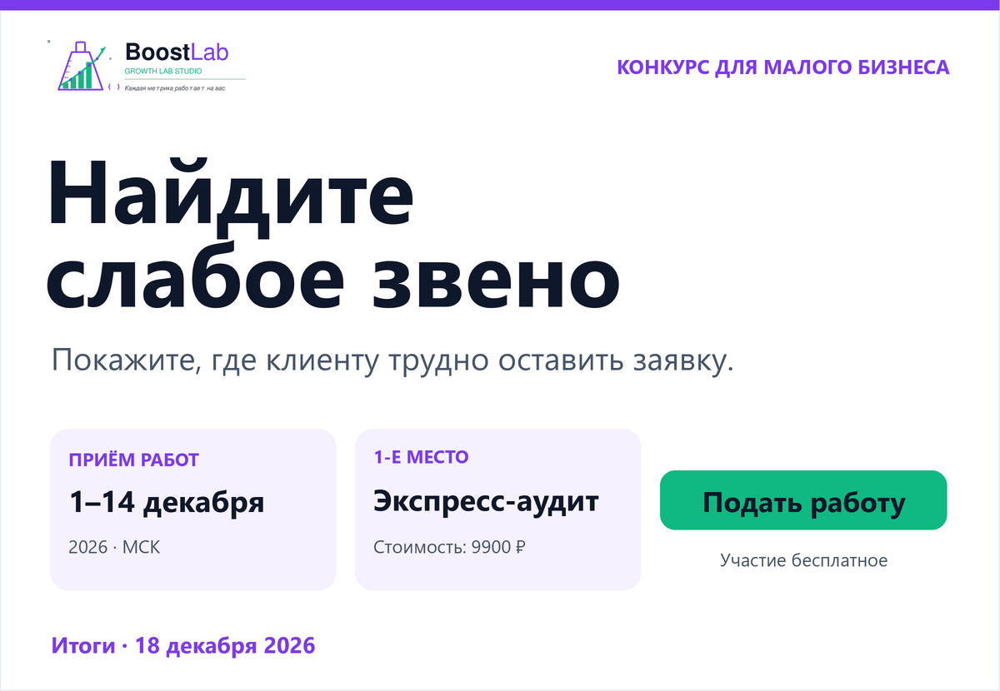

# Лабораторная работа № 14. Чат-бот, квиз и конкурс BoostLab

Цель работы: спроектировать три формата, которые помогают владельцу малого бизнеса проверить путь заявки. Бот, квиз и конкурс ниже - учебные прототипы. Они не размещены и не собирают данные.

## 1. Чат-бот «Линза»

**История и характер.** Линза - виртуальный помощник лаборатории BoostLab. Его придумали для первого разговора, когда владелец сайта видит мало заявок, но не знает, где начать проверку. Линза говорит короткими фразами, задаёт по одному вопросу и не выдаёт предположение за диагноз. Он сразу представляется ботом и в любой момент предлагает перейти к человеку.

**Формат.** Кнопочный сценарный бот для виджета на сайте. Один запрос разобран полностью: «На сайте мало заявок. Что проверить?» Он подходит для действующего сайта сервисной компании; магазин и B2B могут использовать ту же логику для заказа или запроса КП. На этапе подсказок бот не просит телефон или пароль.

*Рисунок 1. В центре один запрос. От него расходятся четыре ответа клиента и соответствующие подсказки; после любого ответа доступна помощь студии.*

**Старт:** «Я Линза, бот BoostLab. Пройдите путь как клиент с телефона. На каком шаге стало непонятно, что делать дальше?»

| Кнопка клиента | Ответ Линзы |
| --- | --- |
| Не вижу кнопку | «Откройте именно ту страницу, куда ведёт объявление. Проверьте, видна ли кнопка записи и не закрывает ли её баннер». |
| Форма не отправляется | «Проверьте, рядом ли с полем показана ошибка. Исправьте номер и попробуйте отправить тест повторно». |
| Заявка не дошла | «Посмотрите, есть ли тест в CRM или общей почте. Попросите ответственного подтвердить, что уведомление пришло». |
| Пока не знаю | «Сделайте пробную запись с телефона. Отметьте первый шаг, на котором не получилось пройти дальше. Можете пройти квиз, чтобы выбрать проверку». |

После подсказки меню: «Проверить другой шаг» возвращает к четырём вариантам; «Пройти квиз» открывает старт квиза ниже; «Помощь студии» ведёт к офферу или передаче оператору. «Закончить» завершает чат без контактов. При вводе вне кнопок: «Не понял ответ. Выберите шаг ниже или нажмите „Помощь студии“». При повторе бот снова показывает выход к человеку, без бесконечных уточнений.

**Реплика при выборе помощи:** «Могу передать вопрос команде или рассказать об экспресс-аудите. Проверка одного пути заявки стоит 9900 ₽ и занимает 3 рабочих дня. Что вам подходит?» Кнопки: «Вопрос команде», «Запросить аудит», «Назад». В рабочей версии после выбора вопроса или аудита бот покажет форму с URL, задачей и одним способом связи; переход к отправке только после явного подтверждения и информирования об обработке данных. Если оператор недоступен: «Команда сейчас не в чате. Можете оставить вопрос в форме или закончить без контактов». В прототипе передачи нет.

## 2. Квиз «Что проверить в пути заявки?»

**Тема:** самопроверка действующего сайта. **Тип:** диагностический квиз, не тест знаний. **Стартовый экран:** «Ответьте на пять вопросов и узнайте, какой шаг проверить первым. Результат покажем без регистрации». Кнопка: «Начать проверку». Один ответ на вопрос, индикатор «1 из 5», кнопка «Назад» сохраняет выбор; без ответа на текущем шаге переход закрыт.

| № | Вопрос | Вариант А | Вариант Б | Вариант В |
| --- | --- | --- | --- | --- |
| 1 | У вас есть действующий сайт с целевым действием? | Да, запись или заявка. | Да, заказ или запрос КП. | Нет, сайт ещё не запущен. |
| 2 | С телефона сразу понятно, что сделать на странице после клика по объявлению или другой входной ссылке? | Да, действие видно и понятно. | Нет, кнопку сложно найти или она непонятна. | Не проверяли. |
| 3 | Вы успешно отправляли тестовую заявку или заказ с телефона? | Да, увидели подтверждение. | Нет, форма дала ошибку или подтверждения не было. | Не проверяли. |
| 4 | Тестовое обращение увидел ответственный сотрудник? | Да, нашли его и подтвердили получение. | Нет, до сотрудника оно не дошло. | Не проверяли. |
| 5 | Вы отдельно считаете успешное обращение, а не только клик по кнопке? | Да, в отчёте есть отдельное событие. | Нет, считаем только клики или не считаем. | Не знаем. |

**Правило выдачи.** Ответ В на вопрос 1 сразу даёт результат «Маршрут до запуска», вопросы 2–5 пропускаются. В остальных случаях показываем все пять вопросов. После вопроса 5 берём первый ответ Б или В среди вопросов 2–5: результат соответствует первому непроверенному или проблемному шагу. Если на все четыре вопроса дан ответ А, показываем «Базовый путь подтверждён». Результат не означает, что найдена причина низкой конверсии.

### Экраны результата

| Результат | Текст на экране | Кнопка и её действие |
| --- | --- | --- |
| Маршрут до запуска (1В) | Опишите, откуда придёт человек, какое действие сделает и кто увидит результат. Проверьте этот путь на прототипе до покупки трафика. | «Пройти заново» возвращает к старту. |
| Начните с первого экрана (2Б/В) | Откройте входную ссылку на телефоне. Сверьте обещание и страницу, найдите кнопку, которая ведёт к нужному действию. | «Запросить аудит» открывает форму после запуска. |
| Проверьте форму (3Б/В) | Отправьте тест. Убедитесь, что видно сообщение об успехе, а ошибку в поле можно исправить без повторного заполнения всей формы. | «Запросить аудит» открывает форму после запуска. |
| Проверьте получение (4Б/В) | Найдите тест в CRM или общей почте. Уточните, получил ли уведомление ответственный и кто должен отвечать. | «Запросить аудит» открывает форму после запуска. |
| Сведите события (5Б/В) | Разведите клик и подтверждённую отправку в отчёте. Сравнивайте события за один период и по одному источнику. | «Запросить аудит» открывает форму после запуска. |
| Базовый путь подтверждён (2А–5А) | Теперь сравните шаги за один период и по одному источнику трафика. Если чего-то не хватает, изучите конкретную страницу или источник, а не перестраивайте сайт наугад. | «Пройти заново» возвращает к старту. |

На четырёх экранах с аудитом рядом с кнопкой размещается текст «Экспресс-аудит пути заявки: 9900 ₽ / 3 рабочих дня». Результат виден до кнопки, контакты для его получения не нужны. На финальных экранах можно закрыть квиз; «Пройти заново» очищает ответы. Контрольный пример: 1А, 2А, 3В, 4Б, 5В → «Проверьте форму», потому что шаг формы идёт раньше получения.

## 3. Конкурс «Найдите слабое звено»

**Планируемая механика:** конкурс по качеству ответа, не случайный розыгрыш. Макет и тексты рассчитаны на сайт студии и соцсети. Даты, призы и форма ниже относятся к учебному сценарию; реального приёма заявок нет.

*Рисунок 2. Макет объявления. Смысловой и визуальный центр - заголовок; под ним слева направо считываются сроки, приз и CTA. Белые поля и контраст отделяют эти блоки, а изумрудная кнопка завершает маршрут.*

### Текст объявления для сайта

#### Найдите слабое звено на своём сайте

Пройдите путь клиента с телефона и покажите, на каком шаге сложнее всего оставить заявку. BoostLab наградит три самых полезных разбора. За первое место - экспресс-аудит пути заявки стоимостью 9900 ₽.

**Кто может участвовать.** Владельцы и сотрудники малых компаний от 18 лет с действующим сайтом (услуги, торговля или B2B), у которых есть разрешение представить этот сайт. Участие бесплатное, покупка и репост не нужны. Одна работа на человека, один сайт в работе.

**Как подать работу.** Откройте сайт с телефона и пройдите путь до записи, заказа или запроса КП. В форме под кнопкой «Подать работу» оставьте ссылку на публичную страницу, один контакт для связи и напишите до 700 знаков: где возникла трудность, как её повторить и что вы предлагаете изменить. Не прикладывайте пароли, контакты клиентов или скриншоты личных кабинетов. После отправки форма подтверждает приём; правки можно прислать через неё до дедлайна, указав тот же контакт (учитывается последняя версия).

**Когда.** Приём: с 1 декабря 2026 года, 09:00, по 14 декабря 2026 года, 23:59 (МСК). Итоги - 18 декабря 2026 года на странице конкурса. Победителям напишет команда BoostLab. На подтверждение приза - 5 календарных дней с уведомления; затем право переходит следующей работе по рейтингу, если она есть.

**Как выбираем.** Команда BoostLab выставит от 0 до 3 баллов по каждому критерию: точность описания проблемы, воспроизводимость и польза предлагаемой правки. Побеждают три работы с наибольшей суммой. При равенстве выше работа с большим баллом за воспроизводимость, затем та, что поступила раньше. Контакт не публикуется; в итогах указывается порядковый номер работы.

**Призы.** 1-е место - экспресс-аудит одного пути заявки стоимостью 9900 ₽ (3 рабочих дня после согласования и получения материалов); 2-е место - онлайн-консультация BoostLab на 30 минут; 3-е место - персональный чек-лист из пяти проверок по присланной странице. С победителями согласуем выдачу в течение 10 календарных дней после подтверждения. Денежной замены нет.

> Подать работу

### Текст объявления для соцсетей

**Конкурс BoostLab: «Найдите слабое звено».** Если у вашей малой компании есть сайт, попробуйте оформить заявку с телефона. Нашли трудный шаг? До 14 декабря 2026 года, 23:59 МСК, отправьте через кнопку «Подать работу» ссылку на страницу и короткий разбор: что мешает, как это повторить и что стоит исправить. Старт 1 декабря в 09:00 МСК. Участвовать могут владельцы и сотрудники от 18 лет с разрешением на представление сайта. Участие бесплатное, одна работа на человека.

1-е место - экспресс-аудит (9900 ₽, 3 рабочих дня после согласования), 2-е - консультация на 30 минут, 3-е - персональный чек-лист. Оцениваем точность, воспроизводимость и пользу правки. Итоги 18 декабря на странице конкурса. Правила и форма - по кнопке «Подать работу».

В макете кнопка неактивна. При согласованном запуске в соцсетях она ведёт на страницу с полными условиями, а на сайте - к форме под правилами. До запуска проверить форму, утверждение призов и публикацию правил; активности и заявок в отчёте нет.
